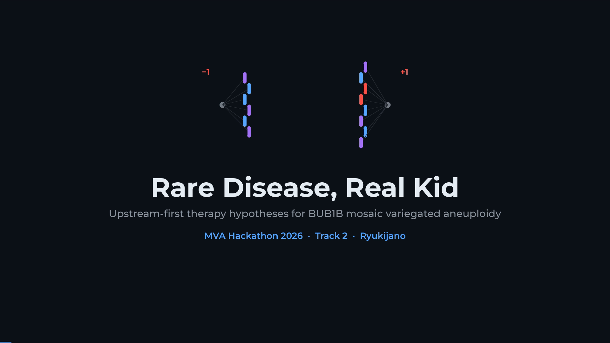
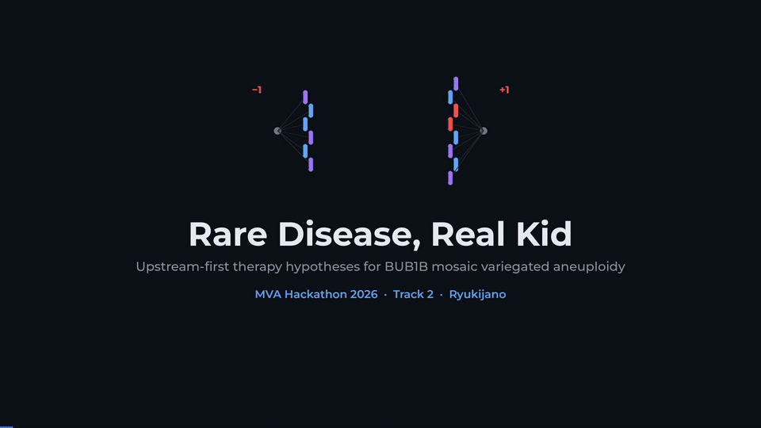
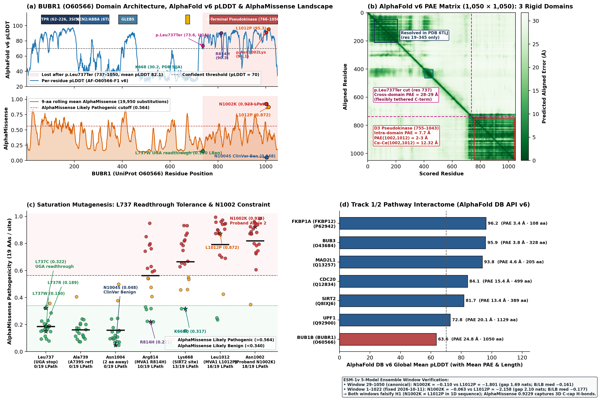
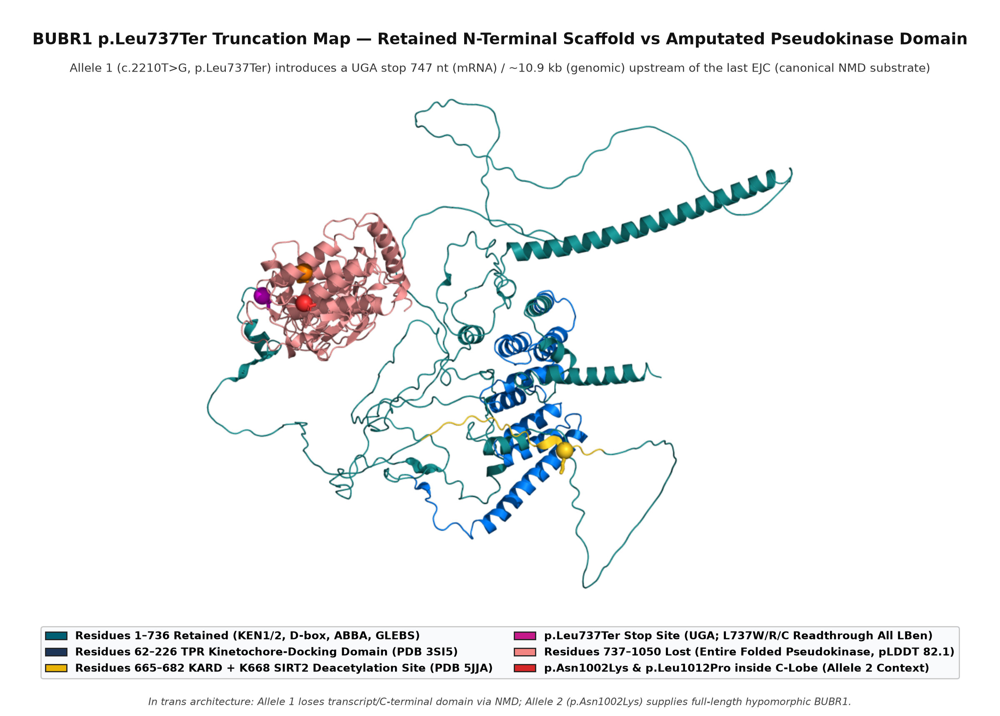
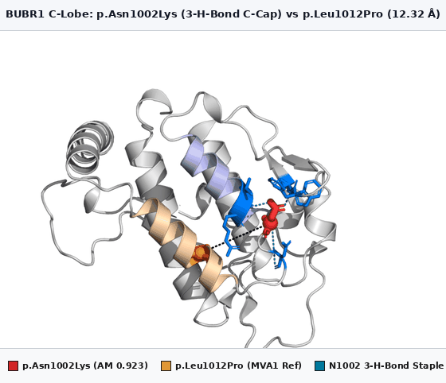
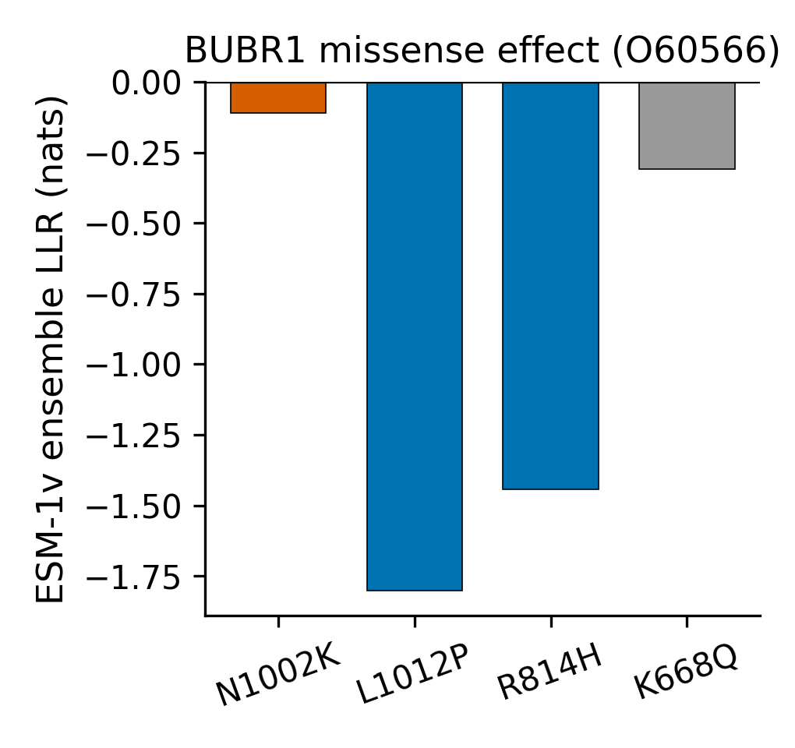
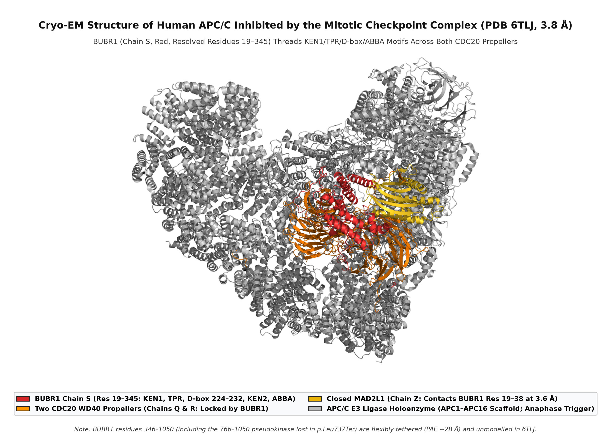
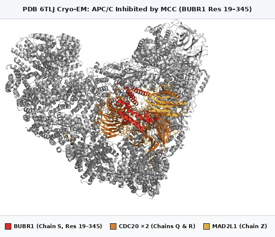
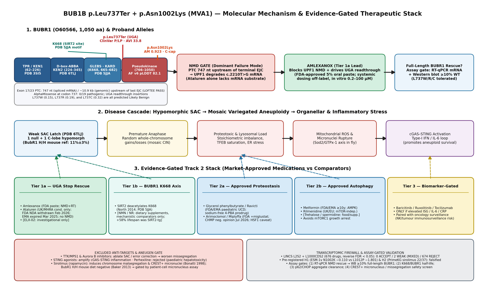

# Rare Disease, Real Kid: MVA Hackathon 2026

[](#the-call-track-1)
[](#the-3-minute-pitch-track-2)
[](tests/)
[](LICENSE)
[](https://huggingface.co/spaces/SageBio/rare-disease-real-kid-mva-hackathon-2026)

> One child. One genome. A 1050-amino-acid checkpoint protein cut short —
> and a computational case for what broke, and what might help.

Code, reports, and figures for
[SageBio/rare-disease-real-kid-mva-hackathon-2026](https://huggingface.co/spaces/SageBio/rare-disease-real-kid-mva-hackathon-2026).

- **HF user:** [Ryukijano](https://huggingface.co/Ryukijano)
- **GitHub:** https://github.com/Ryukijano/mva-hackathon-2026 (public; CC BY 4.0)
- **Campaign wrap-up:** [`WHAT_WE_DID.md`](WHAT_WE_DID.md) · **Structural & pLM addendum:** [`docs/structure_and_plm_addendum_2026-10-11.md`](docs/structure_and_plm_addendum_2026-10-11.md)



## The 3-minute pitch (Track 2)

https://github.com/user-attachments/assets/9fbcac33-27c9-40d2-ac94-f2df7fb43884

*Preclinical N-of-1 research proposal, not clinical advice or a treatment recommendation.*
Rendered locally: script → Kokoro-82M TTS → matplotlib scenes → ffmpeg. Pipeline:
[`video/`](video/) · QA checks: [`video/qa.py`](video/qa.py)

[](https://github.com/user-attachments/assets/9fbcac33-27c9-40d2-ac94-f2df7fb43884)

## The call (Track 1)

> **Submitted 12 Sep 2026 — scorer-confirmed: full match at rank 1, 100/100 rank points, F-max 1.000 at EPCR 0.95 (1/6 shots spent).** The scorer's full match confirms our compound-het call against the hackathon ground truth; clinically, p.Asn1002Lys (`c.3006T>G`) remains a VUS-grade novel missense.

A child with classic **mosaic variegated aneuploidy 1 (MVA1)** — microcephaly,
growth delay, Dandy-Walker malformation, childhood cancers. After annotating the
proband WGS with VEP 116 + AlphaMissense + popEVE and filtering a 17-gene
MVA/Atelis panel to rare functional alleles, **only *BUB1B* carried two hits**:

| Allele | GRCh38 | HGVS (NM_001211.6) | Evidence |
|---|---|---|---|
| 1 | `chr15:40,209,701 T>G` | `c.2210T>G` `p.Leu737Ter` | ClinVar **Pathogenic/Likely pathogenic** for MVA1 ([VCV000533901](https://www.ncbi.nlm.nih.gov/clinvar/variation/533901/), multi-submitter); gnomAD v4 AC=115 exomes (`AF 7.87e-05`), AC=5 genomes, 0 homozygotes; LOFTEE HC-LoF, `50_BP_RULE:PASS` (747 nt spliced mRNA / ~10.9 kb genomic upstream of last EJC) — canonical NMD substrate; [AlphaGenome Atlas (AVI Phred 33.76)](https://alphagenome.models.deepmind.com/?variant=chr15%3A40209701%3AT%3EG) |
| 2 | `chr15:40,220,612 T>G` | `c.3006T>G` `p.Asn1002Lys` | gnomAD v4 singleton (AC=1 exome, `AF 6.84e-07`, `rs2542593804`); SIFT 0.01 / PolyPhen 0.997 / AlphaMissense **0.9229** (`18/19 LPath` at residue 1002); phyloP100way **4.80**; same protein change is a ClinVar VUS via `c.3006T>A` ([VCV004600147.1](https://www.ncbi.nlm.nih.gov/clinvar/variation/4600147/)); this `T>G` allele is ClinVar-absent; [AlphaGenome Atlas (AVI Phred 25.61)](https://alphagenome.models.deepmind.com/?variant=chr15%3A40220612%3AT%3EG) |

EPCR `0.95`, `finding_type=primary`, one row. The truncating + hypomorphic
missense architecture is the canonical *viable* MVA1 pattern (Hanks 2004;
biallelic null is embryonic lethal). Read-backed phasing was **unresolved**
(10.9 kb gap ≫ 1.3 kb max insert — a structural short-read limit, not evidence
against *trans*); the scorer's full match resolves the primary call as
compound-het *in trans* against the hackathon ground truth.



<p align="center">
  
  
</p>

*Left — AlphaFold DB v6 (`AF-O60566-F1`), BUBR1. Teal/navy: residues 1–736 retained by the stop-gain
allele (all SAC degron motifs, TPR `62–226` [`PDB 3SI5`], GLEBS, and KARD `668–675` [`PDB 5JJA`]). Salmon: residues 737–1050 lost —
the entire folded C-terminal pseudokinase domain (`mean pLDDT = 82.05`, `85.7% > 70`). Right — the C-lobe in 3D. Red: `p.Asn1002Lys`
(this proband; buried C-cap of α-helix `990–1001` forming 3 H-bonds to `Trp978:N 2.83 Å`, `Val998:O 2.83 Å`, `Asn1004:O 3.14 Å`). Orange: the `p.Leu1012Pro` MVA1 literature comparator in neighboring α-helix `1008–1020`, `12.32 Å` (`Cα–Cα`) away (`PAE = 2–3 Å`).*

## How we checked ourselves

Before spending a submission shot we ran a **falsifier audit**
(`supplement/track1/locus_falsifier_audit.md`):

- every *BUB1B* ClinVar P/LP allele → only L737Ter present
- the known upstream regulatory SNP `chr15:40,117,088 G>A` → homozygous-ref at 46× depth
- CNV / SV / UPD / homozygous alternatives → none
- the rare intervening intronic SNV → SpliceAI 0.00, phyloP −0.41, no rsID
- **panel-completeness gap we caught ourselves:** the original 15-gene panel was
  missing **SLF2/SMC5** (MVA5/6 Atelis genes) — post-hoc check found only common
  polymorphisms in both; panel now 17 genes

Residual limitation disclosed everywhere: short-read SNV calling cannot exclude
cryptic structural/deep-intronic mechanisms; definitive phase needs parental
genotyping or long-range PCR + long reads.

## Pre-registered computation — both hypotheses failed as written

Two hypotheses were pre-registered before scoring
(`experiments/2026-08-31_bub1b_computational/protocol.md`). Both were falsified —
we report that, because the negative results are the result.



- **H1 — N1002K is an L1012P-class missense: NO.** ESM-1v ensemble LLR (in-house,
  unverified): N1002K **−0.110** vs L1012P **−1.801** — a 1.69-nat gap, far
  outside the pre-registered 0.5-nat window. ClinVar B/LB control: N1002K ranks
  18/34, weaker than the benign median. AlphaMissense 0.9229 disagrees; we report
  both.
- **H2 — PrimeKG puts sirolimus next to MVA: NO.** Skip-gram rank 22/37 — JAK
  inhibitors rank higher, and so does the anti-target TTK inhibitor BOS172722.
  The graph was never trained; no AI "discovered" a therapy here.

## The reaction the checkpoint runs (Track 2 framing)

<p align="center">
  
  
</p>

*PDB 6TLJ — the spindle assembly checkpoint in action. Grey: APC/C (the E3 ligase
that drives anaphase). Red: full-length **BUBR1 threading between the two CDC20
WD40 propellers (orange)**, with MAD2A (yellow). This is the molecular "reaction"
that p.Leu737Ter weakens.*

Because L737Ter is a canonical **NMD substrate** (50-bp rule passes), Track 2 is
gated by transcript rescue:

| Tier | Mechanism | Lead |
|---|---|---|
| **1a** | NMD inhibition + PTC readthrough | **amlexanox** (approved topical paste; systemic use investigational); ataluren (UGA-selective readthrough; UK/MHRA conditional, under review — no live FDA application, no demonstrated NMD inhibition); ELX-02 (investigational) |
| 2 | Proteostasis / chaperone | glycerol phenylbutyrate (Ravicti, FDA/EMA urea-cycle), arimoclomol (FDA with miglustat for NPC ≥2y; EU: CHMP negative opinion Jul 2026, re-examination requested) |
| 2c | mTORC1-independent autophagy | metformin, rilmenidine (approved); trehalose/spermidine (supplements) |
| 3 | Biomarker-gated immunomodulation | JAK/IL-6 only if IFN/IL-6 signature — with oncology surveillance |
| ✗ | **Anti-targets** | TTK/AURKB inhibitors, STING agonists, and sirolimus (mTORC1 inhibition *reported* to promote missegregation — Bonatti 1998; contested — flagged, not a lead) |



## What the transcriptomic screen actually said

LINCS/L2S2 + L1000CDS2 reversal screen over MVA/hypomorph GEO signatures,
gated on directional reverse FDR with a multi-stage firewall:

**`0 ACCEPT / 2 WEAK / 674 REJECT`** — reported as a negative result, not a
rescue claim. Both weak hits (sirolimus, dasatinib) are MIXED-direction: each
shows one FDR-significant reverse signature in the pooled single-donor
GSE22206 contrast and mimic signatures elsewhere. The screen also cannot test
readthrough or NMD mechanisms at all — absence of a hit is not evidence against
the upstream stack.

Full dossier: `track2/track2_report.md` → `submissions/Ryukijano_track2_report.md`.

## Reproduce

```bash
# AIRE cluster
source /scratch/kcwp264/.aire_scratch_env.sh
conda env create -f environment.yaml && conda activate mva-hackathon
pip install -e .

# gated data (after accepting the DTA)
export HF_TOKEN=...
python scripts/download_data.py
bash scripts/setup_references.sh

python scripts/run_track1.py \
  --vcf data/<proband_wgs>.vcf.gz \
  --pheno data/Challenge_Clinical_Phenotype_1.docx \
  -o submissions/Ryukijano_bub1b-compoundhet.csv
python -m pytest tests/ -q          # 39 tests incl. the scorer clone

# the pitch video
cd video && ./make.sh               # TTS → render → assemble → qa
```

## Repo map

```
configs/            17-gene panel, thresholds, AIRE paths
src/mva_hackathon/  variants (VEP parse, filter, score, pair, writer), eval (scorer clone)
scripts/            CLI + Slurm wrappers + WGS/phasing utilities
experiments/        ESM-1v, PrimeKG, ClinVar B/LB — see 2026-08-31_bub1b_computational/SUMMARY.md
track2/             ChEMBL screen, LINCS/L2S2, dossier, storyboard
video/              script, Kokoro TTS, matplotlib renderer, assembler, QA — final pitch in out/
submissions/        Track 1 CSV + both reports
supplement/         locus falsifier audit
figures/            PyMOL scripts, structures, PNGs, rotating GIFs, .pse sessions
tests/              39 tests (scorer parity, CSV schema, config)
docs/               project record, phasing memo, first-principles doc
```

## Data handling & AI disclosure

- Genome / BAM / VCF stay off this repo and must be deleted within 30 days of close.
- AI assistance: Anthropic API / agents (Claude, Cursor, Devin) under commercial terms — no training on inputs. Local models: ESM-1v (`facebook/esm1v_t33_650M_UR90S_{1–5}`), Kokoro-82M TTS (video voice-over). Genome-scale files were never sent to third-party LLM APIs.
- This is a preclinical N-of-1 research proposal, not clinical advice or a treatment recommendation.

## Licence

Code, reports, figures: [CC BY 4.0](LICENSE). Patient data: gated, not redistributable.
