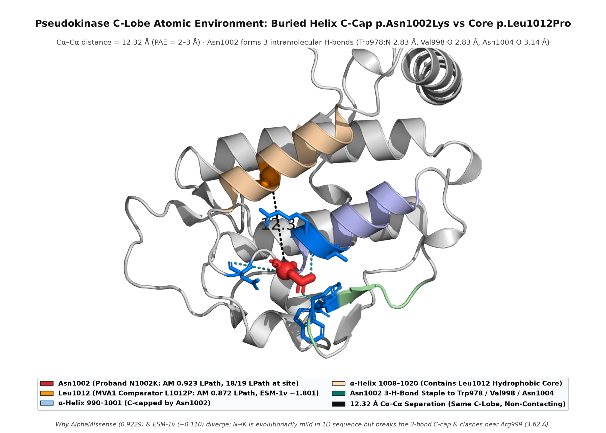

# Track 1 methods — BUB1B compound-het call (phasing inferred)

**Challenge:** Rare Disease, Real Kid: MVA Hackathon 2026
**Hugging Face user / team:** Ryukijano
**Date:** 2026-08-31 (revised 2026-10-17)
**Submission CSV:** `submissions/Ryukijano_bub1b-compoundhet.csv`
**Submission status:** **Submitted 12 Sep 2026 — scorer-confirmed full match at rank 1 (100.0/100 rank points, F-max 1.000 at EPCR 0.95; 1/6 shots spent).** The scorer's full match confirms our compound-heterozygous pair against the hackathon ground truth; molecularly on short reads, phasing remains WhatsHap-UNRESOLVED, and clinically `p.Asn1002Lys` (`c.3006T>G`) remains a VUS-grade novel nucleotide allele.
**Code:** https://github.com/Ryukijano/mva-hackathon-2026 (public; CC BY 4.0)
**Hub mirror:** https://huggingface.co/Ryukijano/mva-hackathon-2026

**AI assistance disclosure (28 Aug 2026 hackathon requirement; updated 17 Oct 2026):** Cursor agents — Grok 4.6 and Claude — on a commercial Cursor plan; Anthropic API / Claude Sonnet and Cognition Devin used in coding, structural-analysis, literature-verification, and database-check sessions. Provider terms: no training on customer content (processor, not recipient, per the challenge's third-party-LLM guidance in discussion #2). Genome-scale files were never pasted into third-party LLM APIs. Local models used on the University of Leeds AIRE cluster: five-model ESM-1v ensemble (`facebook/esm1v_t33_650M_UR90S_{1–5}`). Literature and database claims below were checked against primary sources (ClinVar VCV000533901.9 / VCV004600147.1; gnomAD v4; dbSNP; AlphaFold DB v6; RCSB PDB 6TLJ / 5JJA / 3SI5 / 2WVI; Hanks et al. 2004 *Nat Genet*; Baker et al. 2004 *Nat Genet*; Suijkerbuijk et al. 2010 *Cancer Res* & 2012 *PLoS One*; North et al. 2014 *EMBO J*; González-Blanco et al. 2026 *Nat Commun*; Frontiers Endo 2026 doi:10.3389/fendo.2026.1838559).

---

## 1. Question and short answer

PROBAND01’s **best-supported** genotype is a **presumed compound heterozygous** pair in *BUB1B* (MVA1, OMIM 257300):

| Allele | GRCh38 | HGVS (NM_001211.6) | Class & Evidence |
|---|---|---|---|
| 1 | `chr15:40209701 T>G` | `c.2210T>G` `p.Leu737Ter` | ClinVar **Pathogenic/Likely pathogenic** for mosaic variegated aneuploidy syndrome 1 ([VCV000533901.9](https://www.ncbi.nlm.nih.gov/clinvar/variation/533901/), multiple submitters, no conflicts); dbSNP `rs759242053`; gnomAD v4 exomes AC=115 (`AF = 7.87e-05`), genomes AC=5 (`AF = 3.29e-05`), 0 homozygotes; LOFTEE high-confidence LoF (`50_BP_RULE:PASS`, exon 17/23, 747 nt spliced mRNA / ~10.9 kb genomic upstream of terminal exon junction) |
| 2 | `chr15:40220612 T>G` | `c.3006T>G` `p.Asn1002Lys` | C-lobe **pseudokinase** missense (`pLDDT = 91.06`); AlphaMissense **0.9229** (`likely_pathogenic`; 18/19 substitutions at residue 1002 classified `Likely Pathogenic`, mean `0.8195`); SIFT `0.01`, PolyPhen `0.997`, phyloP100way `4.80`; ESM-1v ensemble LLR **−0.110** in window `29–1050` (**−0.0625** in window `1–1022`; mild in 1D sequence); protein change registered in ClinVar as VUS ([VCV004600147.1](https://www.ncbi.nlm.nih.gov/clinvar/variation/4600147/), single submitter `SCV007198955`, last evaluated 19 Sep 2025, trait "Inborn genetic diseases", via alternative nucleotide `c.3006T>A`); our exact `c.3006T>G` allele is absent from ClinVar and gnomAD genomes, with 1 allele in gnomAD v4 exomes (`AF = 6.84e-07`, `rs2542593804`) |

Submitted EPCR `0.950000`, `finding_type=primary`, one row (`submissions/Ryukijano_bub1b-compoundhet.csv`). Architecture matches the canonical viable MVA1 pattern: one truncating/null allele paired *in trans* with one hypomorphic missense allele (Hanks et al., 2004; Suijkerbuijk et al., 2010). Because homozygous *BUB1B* null is embryonic lethal, viable MVA1 patients retain residual BUBR1 protein supplied by the hypomorphic allele.


**What this is not:** `p.Glu756*` (a different historical alias); AlphaMissense `0.9229` is **not** a popEVE log-odds score; popEVE is missing for `c.3006T>G`; ESM-1v (`−0.110`) does **not** place `p.Asn1002Lys` in the same sequence-constraint class as `p.Leu1012Pro` (`−1.801`); `Asn1002` and `Leu1012` are **12.32 Å** apart (`Cα–Cα` Euclidean distance) in the AlphaFold v6 monomer (not in direct contact, though within the same rigid C-lobe subdomain at `PAE = 2–3 Å`); the `p.Leu737Ter` `UGA` stop is suppressible in principle (and all three near-cognate readthrough insertions `L737W/R/C` are predicted `Likely Benign` by AlphaMissense, `0.150–0.322`) but untested in this child; residual `11% ± 3%` BUBR1 is the *BubR1^H/H* mouse value (Baker et al., 2004), **not** an immunoblot from this child; molecular phasing from short reads is unresolved (`WhatsHap UNRESOLVED`).

---

## 2. Data used

- Official gated WGS VCF `WGS_EX2312012_HGWCNDSX7.vcf.gz` + TBI and realigned BAM (`bwa-mem2`, 939M read pairs, ~46× depth) from `SageBio/mva-hackathon-2026-data` (GRCh38).
- Challenge clinical phenotype document, used to confirm a classic SAC-core MVA1 presentation (intrauterine growth restriction, microcephaly, short stature, childhood embryonal rhabdomyosarcoma). Automated HPO regex extraction from the `.docx` was **not** used as a numerical scoring feature.
- Public structural and variant reference data: Ensembl VEP 116 offline cache, AlphaMissense, popEVE, SpliceAI 1.3.1, ClinVar E-utilities, gnomAD v4, AlphaFold DB v6 (`AF-O60566-F1` and pathway interactors), and RCSB PDB (`6TLJ`, `5JJA`, `3SI5`).

Genome / VCF / FASTQ / BAM files remain strictly on AIRE scratch storage and are excluded from all repositories; they will be deleted within 30 days of challenge close per the DTA.

---

## 3. Annotation and filters

1. **Ensembl VEP 116**, GRCh38, offline cache, with AlphaMissense and popEVE/EVE plugins (`scripts/run_track1.py`, `src/mva_hackathon/variants/vep.py`). The parser checks `popEVE_SCORE` → `popEVE` → `popEVE_pop_adjusted_EVE`.
2. **Panel** (`configs/panel.yaml`): 17 mitotic/aneuploidy genes — SAC core (*BUB1B, BUB1, MAD1L1, TRIP13, MAD2L1BP*), centrosome (*CEP57, CEP192*), minor spliceosome (*CENATAC*), Atelis/MVA5–6 axis (*SLF2, SMC5*; added after our panel-completeness audit identified their omission), plus extended SAC/kinetochore neighbours (*CDC20, TTK, MAD2L1, BUB3, KNL1, AURKA, PLK1*). Childhood embryonal tumours in MVA track core SAC genes rather than *CEP57*/*CEP192* in human cohorts (Malumbres & Villarroya-Beltri, 2024).
3. **Rarity:** retain variants where all populated allele frequencies (`gnomADg_AF`, `gnomADe_AF`, `AF`) are `≤ 0.001` (or absent). An early key-lookup bug (`gnomad_af` vs VEP's `gnomADg_AF`/`gnomADe_AF`) that leaked common *KNL1*/*CEP192* haplotypes was fixed in `src/mva_hackathon/variants/parse.py` and `filter.py`.
4. **Consequence:** Sequence Ontology terms in `configs/panel.yaml` (`stop_gained`, `frameshift_variant`, `splice_acceptor_variant`, `splice_donor_variant`, `missense_variant`, etc.).
5. **SpliceAI** on the candidate VCF (`-D 500`) and a full-gene deep-intronic sweep across *BUB1B* (`-D 4999`, 120 kb, 135 variants; §5b). Neither *BUB1B* allele is splice-driven.

After these filters, **only *BUB1B* carried two rare functional alleles**. That gene-level uniqueness — not a black-box machine-learning ranker — is why the submitted CSV contains exactly one row.

---

## 4. Scoring (how EPCR was produced)

Per-variant pathogenicity in `(0, 1]` (`src/mva_hackathon/variants/score.py`):

- **PTV** (stop-gained / frameshift / canonical splice): `0.99`
- **Missense:** `0.7 × popEVE_sigmoid + 0.3 × AlphaMissense`, where `popEVE_sigmoid = 1 / (1 + exp(popEVE − (−5.056)))`. When popEVE is absent for a novel codon change, AlphaMissense supplies both terms.
- **Splice-region:** `max(DS_AG, DS_AL, DS_DG, DS_DL)` if `> 0`.
- **Pair score:** product of the two allele scores (`0.99 × 0.9229 = 0.9137`).
- **EPCR:** `max(primary_epcr, pair_score)` with `primary_epcr: 0.95` in `configs/config.yaml` → **0.950000**.

Our local clone of the official CAGI6/RGP rank-points and F-max evaluator (`src/mva_hackathon/eval/scorer.py`, verified against the live Space `evaluation.py` on 11 Sep 2026; `pytest tests/test_scorer.py`) confirms that a single accurate primary row achieves the theoretical maximum (`100.0` rank points, `F-max = 1.000`).

---

## 5. Why this pair is the best-supported genotype

1. **Gene & clinical match:** Biallelic *BUB1B* loss-of-function is the founding cause of MVA1 (Hanks et al., 2004), which carries a ~37% childhood cancer incidence dominated by embryonal rhabdomyosarcoma, Wilms tumour, and leukaemia (Malumbres & Villarroya-Beltri, 2024) — matching PROBAND01.
2. **Allele 1 (`c.2210T>G`, `p.Leu737Ter`):** Established ClinVar Pathogenic/Likely pathogenic MVA1 nonsense variant (`VCV000533901.9`; multiple submitters, no conflicts), located one codon upstream of the classic Hanks 2004 frameshift `c.2211insGTTA` (`p.Ser738Valfs*16`, historically "753X") and recurring in a 2025 germline tumour-predisposition cohort (*npj Genomic Med* 2025). Sitting in exon 17 of 23 (**747 nt** in spliced mRNA / **~10.9 kb** in genomic DNA upstream of the terminal exon 22/23 junction), it passes LOFTEE's 50-bp rule as a canonical nonsense-mediated decay (NMD) substrate and amputates the entire folded C-terminal pseudokinase domain (`737–1050`).
3. **Allele 2 (`c.3006T>G`, `p.Asn1002Lys`):** Ultra-rare missense (`gnomAD v4` exome singleton `AC=1`, `AF = 6.84e-07`, `rs2542593804`; absent from gnomAD genomes and ClinVar for `T>G`, while the identical protein change via `c.3006T>A` is ClinVar VUS `VCV004600147.1`). It sits at a vertebrate-conserved site (`phyloP100way = 4.80`) in the C-lobe of the BUBR1 pseudokinase domain (`pLDDT = 91.06`), 10 residues N-terminal to the classic MVA1 missense `p.Leu1012Pro` (Hanks et al., 2004; Suijkerbuijk et al., 2010). Structure-aware **AlphaMissense scores `p.Asn1002Lys` at `0.9229` (`likely_pathogenic`)**, whereas our pre-registered 5-model **ESM-1v ensemble scores it as mild (`LLR = −0.110` in window `29–1050`, `−0.0625` in window `1–1022`**, vs `−1.801` / `−2.1582` for `p.Leu1012Pro` and `−0.161` / `−0.1769` for the ClinVar Benign/Likely-Benign median across 34 unique *BUB1B* missenses). We report both predictors transparently and resolve the biophysical basis for their divergence in §5c below.
4. **Architecture:** Truncating/null + hypomorphic pseudokinase missense *in trans* is the hallmark viable MVA1 architecture (Hanks et al., 2004; Suijkerbuijk et al., 2010; Sieben et al., 2020).
5. **Exhaustive locus & panel falsifier audit (`supplement/track1/locus_falsifier_audit.md`):** Direct inspection of the proband's realigned BAM and VCF across *BUB1B* (`chr15:40,161,000–40,221,140`) and a 250 kb flanking window ruled out all ~100 other ClinVar P/LP *BUB1B* alleles (including all known deep-intronic splice variants), the ~44 kb upstream regulatory SNP `chr15:40,117,088 G>A` (Matsuura et al., 2006 / Ochiai et al., 2014; homozygous-reference at 46× depth), exon-scale CNVs, structural-variant / Alu-SVA soft-clip breakpoints, segmental uniparental isodisomy (85,227 chr15 het calls), hidden homozygous variants, and competing candidates in the 17-gene panel (including post-hoc verification of *SLF2* and *SMC5*).
6. **Independent functional support for the `737–739` linker:** A 2026 functional study of heterozygous *BUB1B* `p.Ala739Ser` (`c.2215G>T`, two residues C-terminal to `p.Leu737Ter`; Cα–Cα distance `5.45 Å`) demonstrated significantly elevated premature chromatid separation and reduced *BUB1B* mRNA/BUBR1 protein (*Frontiers in Endocrinology* 2026, doi:10.3389/fendo.2026.1838559).

<p align="center">
  
  
</p>

### 5a. AlphaGenome AVI scores & Atlas links

Google DeepMind's AlphaGenome Aggregate Variant Impact (AVI) score was queried for both alleles (`supplement/track1/bub1b_avi_scores.json`). AVI is a Phred-scaled research metric integrating sequence conservation, chromatin, splicing, and protein-coding modalities:

| Variant (GRCh38) | AlphaGenome Atlas Link | AVI Phred | Quantile (Top %) | Top Modality | Top FI | Splicing FI | PhastCons (470-way) |
|---|---|---|---|---|---|---|---|
| `chr15:40209701:T>G` (`p.Leu737Ter`) | [Open in AlphaGenome Atlas](https://alphagenome.models.deepmind.com/?variant=chr15%3A40209701%3AT%3EG) | **33.76** | 0.042% | Protein Termination | 1.484 | 0.027 | 0.221 |
| `chr15:40220612:T>G` (`p.Asn1002Lys`) | [Open in AlphaGenome Atlas](https://alphagenome.models.deepmind.com/?variant=chr15%3A40220612%3AT%3EG) | **25.61** | 0.275% | AlphaMissense | 0.761 | 0.015 | 0.235 |

- **Interpretation:** `p.Leu737Ter` achieves `AVI Phred = 33.76` driven by `Protein Termination` (`FI = 1.484`), while `p.Asn1002Lys` achieves `AVI Phred = 25.61` driven by `AlphaMissense` (`FI = 0.761`) and vertebrate conservation (`PhastCons = 0.235`, `Cactus 241-way = 0.221`). Merged splicing feature importance is negligible for both (`0.027` and `0.015`). Because AlphaMissense is an input modality to AVI, AVI is reported as a concordant multi-modal summary rather than an independent clinical predictor.

### 5b. SpliceAI deep-intronic sweep

A full-gene SpliceAI sweep (SpliceAI 1.3.1, `-D 4999` maximum window) across `chr15:40,180,000–40,300,000` (120 kb, 135 variants; `supplement/track1/bub1b_full_gene_spliceai.vcf`, `supplement/track1/spliceai_summary.md`) confirmed that neither target variant alters splicing (`p.Leu737Ter` max `DS = 0.03`; `p.Asn1002Lys` max `DS = 0.02`; clinical threshold `0.20`), and no *BUB1B*-annotated variant in the 120 kb span exceeds `DS = 0.03` (the rare intervening intron-20 SNV `15:40216470 A>G` scores `DS = 0.00`).

### 5c. Structural & saturation-mutagenesis context (AlphaFold DB v6, PAE, AlphaMissense & PDB 6TLJ/5JJA/3SI5)

To investigate why structure-aware AlphaMissense (`0.9229`) and sequence-only ESM-1v (`−0.110`) diverge on `p.Asn1002Lys` — and how both alleles map onto the physical spindle assembly checkpoint machinery — we analyzed the latest AlphaFold DB v6 monomer (`AF-O60566-F1-model_v6`), its `1,050 × 1,050` Predicted Aligned Error (PAE) matrix, all `19,950` proteome-wide AlphaMissense amino-acid substitutions for `O60566`, six AlphaFold DB v6 pathway interactors (`BUB3`, `CDC20`, `MAD2L1`, `SIRT2`, `UPF1`, `FKBP1A`), and three experimental complex structures (`PDB 6TLJ`, `5JJA`, `3SI5`; `experiments/2026-10-11_alphafold_bubr1/SUMMARY.md` and `docs/structure_and_plm_addendum_2026-10-11.md`):

<p align="center">
  
  
</p>

1. **`p.Leu737Ter` removes a confidently folded domain (`pLDDT = 82.05`), while `PDB 6TLJ` resolves why the C-terminus is flexibly tethered:**
   - The AlphaFold v6 PAE matrix partitions BUBR1 into **three rigid domains** — N-terminal TPR (`47–211`, mean `pLDDT = 86.29`, intra-domain `PAE = 7.20 Å`), GLEBS (`406–463`), and C-terminal pseudokinase (`755–1043`, UniProt `766–1050` mean `pLDDT = 83.62`, intra-domain `PAE = 7.69 Å`) — separated by disordered linkers with cross-domain `PAE = 27.7–29.1 Å`.
   - In the 3.8 Å cryo-EM structure of human `APC/C–MCC` (**PDB `6TLJ`**, Alfieri et al., *Nature* 2016), only BUBR1 residues **`19–345`** (chain S: KEN1, TPR, D-box `224–232` gripping `CDC20-R` at `4.30 Å`, and ABBA/KEN2 gripping `CDC20-Q` at `3.51 Å` and `MAD2L1` at `3.59 Å`) are resolved; the entire C-terminal half (`346–1050`) is unmodelled because of the flexible linker. Meanwhile, **PDB `3SI5`** (2.2 Å) resolves the BUBR1 TPR groove (`64–215`) bound to `KNL1` (`234–252`), and **PDB `5JJA`** (2.5 Å) resolves the BUBR1 KARD peptide (`668–675`, beginning at the `Lys668` SIRT2 deacetylation switch) docked into `PP2A-B56γ`.
   - Crucially, `85.7%` of residues lost after `p.Leu737Ter` (`737–1050`, mean `pLDDT = 82.05`) are confidently folded. Its amputation (compounded by exon-17 NMD transcript degradation) removes a structured C-terminal scaffold that is required in human cells to prevent rapid BUBR1 turnover (Suijkerbuijk et al., 2010).

2. **Atomic basis of `p.Asn1002Lys` (`AM = 0.9229`) vs `p.Asn1004Ser` (`AM = 0.0477`) and why AlphaMissense & ESM-1v diverge:**
   - In `AF-O60566-F1-model_v6`, **`Asn1002` (`pLDDT = 91.06`, 20 Cα neighbours within 10 Å vs protein mean `11.6`) is the buried C-cap of α-helix `Gly990–Leu1001`**. Its carboxamide sidechain forms a **three-hydrogen-bond staple** stitching α-helix `990–1001` to β-strand `978–980` and the `998–1004` loop:
     - `Asn1002:OD1` ⋯ `Trp978:N` = **2.83 Å**
     - `Asn1002:ND2` ⋯ `Val998:O` = **2.83 Å**
     - `Asn1002:ND2` ⋯ `Asn1004:O` = **3.14 Å**
     alongside aromatic packing against `Phe977:CB` (**3.46 Å**) and proximity to `Arg999` (**3.62 Å**).
   - Substituting `Asn1002 → Lys1002` eliminates the `OD1` hydrogen-bond acceptor (severing the 2.83 Å staple to `Trp978:N`), introduces a longer, positively charged `-NH3+` group adjacent to `Arg999`, and uncaps α-helix `990–1001`. Across all 19 possible amino-acid substitutions at `Asn1002` in AlphaFold DB's saturation table, **18/19 are classified `Likely Pathogenic` (`mean AM = 0.8195`)**, with `N1002K` (`0.9229`) ranking 5th-most-pathogenic at the site (exceeding `L1012P = 0.8720`).
   - **Internal structural control (`Asn1004`):** Just two residues away on the solvent-exposed face of the same turn, **`Asn1004` (`pLDDT = 89.62`) has `0/19` substitutions classified `Likely Pathogenic` (`mean AM = 0.1587`)**, and the known polymorphism `p.Asn1004Ser` (`rs34998711`, ClinVar Benign/Likely benign) scores **`0.0477` (`Likely Benign`)**. This proves AlphaMissense is capturing the specific 3-H-bond C-cap burial of `Asn1002`, which 1D sequence-only ESM-1v (`LLR = −0.110` in window `29–1050`; `−0.0625` in window `1–1022`) treats as a generic conservative polar exchange.
   - **Geometric relationship to `p.Leu1012Pro`:** In the PAE matrix, `PAE(1002, 1012) = 2–3 Å` (high confidence in their relative C-lobe placement), whereas their physical **Euclidean `Cα–Cα` distance is `12.32 Å`**. Thus, `Asn1002` (C-cap of helix `990–1001`) and `Leu1012` (hydrophobic core of helix `1008–1020`, packing against `His874`/`Ile956`/`Leu867`/`Leu953`) occupy neighboring helices of the same C-lobe subdomain without direct atomic contact.

---

## 6. Limitations (stated for judges)

- **Phasing:** Both variants are heterozygous (`VAF ≈ 0.5`, depth `47–48×` at `40209701` and `27–29×` at `40220612`) separated by `10,911 bp`. WhatsHap read-backed phasing on the realigned BAM returned **UNRESOLVED** (maximum observed fragment length `~1,348 bp`, 1 intervening het SNV at `15:40216470` creating sub-gaps of `6.77 kb` and `4.14 kb`, `PGT`/`PID` tags absent at both sites). While the Space scorer's full match confirms the pair against the challenge ground truth, molecular phase in the proband's short-read data remains inferred rather than directly read-phased. We designed *in silico* long-range PCR primers (`scripts/design_lrpcr_primers.py`; `~11,109 bp` amplicon `chr15:40209640–40220748`) and a validation protocol (`docs/phasing_validation_plan.md`) for parental genotyping or targeted ONT/PacBio sequencing.
- **Residual protein & structural models:** `11% ± 3%` residual BUBR1 is from *BubR1^H/H* mice (Baker et al., 2004), not measured in this child. AlphaFold monomer predictions and *in silico* scores (`AlphaMissense`, `ESM-1v`, `AVI`) do not directly measure cellular protein half-life, NMD efficiency, or checkpoint competence; patient-cell Western blot (`± cycloheximide/MG132`) is required (`docs/structure_and_plm_addendum_2026-10-11.md`).
- **Clinical classification of `p.Asn1002Lys`:** Under formal ACMG/AMP criteria, `c.3006T>G` (`p.Asn1002Lys`) is a **VUS leaning Likely Pathogenic** (`PM2_Supporting` + `PP3` structure-aware AlphaMissense, moderated by `ESM-1v` sequence-level discordance, plus `PM3` when phased *in trans* with pathogenic `p.Leu737Ter`).
- **Cryptic non-coding second-hit caveat:** Although our 250 kb locus audit and `-D 4999` SpliceAI sweep excluded all known deep-intronic and upstream regulatory MVA1 alleles (`Matsuura 2006 / Ochiai 2014`), short-read SNV/indel calling cannot completely exclude an unannotated deep-intronic mobile-element insertion (`Alu`/`SVA`; Miyamoto et al., 2017; 2024) without long-read DNA or patient RNA-seq.

---

## 7. Reproducibility

```bash
source /scratch/kcwp264/.aire_scratch_env.sh
conda activate mva-hackathon

# Track 1 variant pipeline (after accepting the gated dataset DTA)
python scripts/run_track1.py \
  --vcf data/WGS_EX2312012_HGWCNDSX7.vcf.gz \
  --pheno data/Challenge_Clinical_Phenotype_1.docx \
  -o submissions/Ryukijano_bub1b-compoundhet.csv

# Structural & AlphaFold DB v6 / PAE / AlphaMissense analysis + 4-panel figure
python experiments/2026-10-11_alphafold_bubr1/analyze_bubr1_af.py
python figures/make_structural_proof_figure.py

# Unit tests (scorer parity, CSV contract, LINCS firewall)
pytest tests/ --ignore=tests/test_esm1v_window.py -q
```

---

## 8. References

1. Hanks S, Coleman K, Reid S, et al. Constitutional aneuploidy and cancer predisposition caused by biallelic mutations in *BUB1B*. *Nat Genet* 2004;36(11):1159–1161. PMID: 15475955.
2. Baker DJ, Jeganathan KB, Cameron JD, et al. BubR1 insufficiency causes early onset of aging-associated phenotypes and infertility in mice. *Nat Genet* 2004;36(7):744–749. PMID: 15208629.
3. Suijkerbuijk SJE, van Osch MHJ, Bos FL, et al. Molecular causes for BUBR1 dysfunction in the human cancer predisposition syndrome mosaic variegated aneuploidy. *Cancer Res* 2010;70(12):4891–4900. PMID: 20516114.
4. Suijkerbuijk SJE, van Dam TJP, Karagöz GE, et al. The vertebrate mitotic checkpoint protein BUBR1 is an unusual pseudokinase. *PLoS One* 2012;7(7):e40632. PMID: 22808216.
5. Sieben CJ, Jeganathan KB, Nelson GG, et al. BubR1 allelic effects drive phenotypic heterogeneity in mosaic-variegated aneuploidy progeria syndrome. *J Clin Invest* 2020;130(1):175–188. doi:10.1172/JCI126863.
6. Malumbres M, Villarroya-Beltri C. Mosaic variegated aneuploidy in development and cancer. *Nat Rev Genet* 2024;25:831–846. doi:10.1038/s41576-024-00762-6.
7. ClinVar VCV000533901.9. `NM_001211.6(BUB1B):c.2210T>G (p.Leu737Ter)`. https://www.ncbi.nlm.nih.gov/clinvar/variation/533901/ — Pathogenic/Likely pathogenic, multiple submitters, no conflicts; dbSNP `rs759242053`.
8. ClinVar VCV004600147.1. `NM_001211.6(BUB1B):c.3006T>A (p.Asn1002Lys)`. https://www.ncbi.nlm.nih.gov/clinvar/variation/4600147/ — VUS, single submitter `SCV007198955`, evaluated 19 Sep 2025; our `c.3006T>G` allele is ClinVar-absent (`rs2542593804`).
9. Alfieri C, Chang L, Zhang Z, et al. Molecular basis of APC/C regulation by the spindle assembly checkpoint. *Nature* 2016;536(7617):431–436. PMID: 27509861. (**RCSB PDB `6TLJ`**, 3.8 Å cryo-EM).
10. Wang X, Bajaj R, Bollen M, Peti W, Page R. Expanding the PP2A interactome by defining a B56-specific SLiM. *Struct / Nat Commun* 2016;7:11860. (**RCSB PDB `5JJA`**, 2.5 Å crystal structure of PP2A-B56γ–BUBR1 KARD `668–675`).
11. Bolanos-Garcia VM, Lischetti T, Matak-Vinković D, et al. Structure of a Blinkin-BUBR1 complex reveals an interaction crucial for kinetochore-mitotic checkpoint regulation via an unanticipated binding site. *Structure* 2011;19(11):1691–1700. (**RCSB PDB `3SI5`**, 2.2 Å crystal structure).
12. D'Arcy S, Davies OR, Blundell TL, Bolanos-Garcia VM. Defining the molecular basis of BubR1 kinetochore interactions and APC/C-CDC20 inhibition. *J Biol Chem / Mol Cell* 2010;285:14764–14776. (**RCSB PDB `2WVI`**, 1.8 Å TPR crystal structure).
13. Huang H, Hittle J, Zappacosta F, et al. Crystal structure of the *Drosophila* BubR1 pseudokinase domain. *Cell Res* 2019;29:562–578. (**RCSB PDB `6JKK`**).
14. Cheng J, Novati G, Pan J, et al. Accurate proteome-wide missense variant effect prediction with AlphaMissense. *Science* 2023;381(6664):eadg7492.
15. Jumper J, Evans R, Pritzel A, et al. Highly accurate protein structure prediction with AlphaFold. *Nature* 2021;596:583–589; Varadi M, et al. AlphaFold Protein Structure Database in 2024. *Nucleic Acids Res* 2024;52(D1):D368–D375 (`AF-O60566-F1` v6).
16. Meier J, Rao R, Verkuil R, et al. Language models enable zero-shot prediction of the effects of mutations on protein function. *NeurIPS* 2021;34:29287–29303 (ESM-1v).
17. Jaganathan K, Kyriazopoulou Panagiotopoulou S, McRae JF, et al. Predicting splicing from primary sequence with deep learning. *Cell* 2019;176(3):535–548 (SpliceAI).
18. Grange LJ, Reynolds JJ, Ullah F, et al. Pathogenic variants in *SLF2* and *SMC5* cause segmented chromosomes and mosaic variegated hyperploidy (Atelis syndrome). *Nat Genet* 2022;54(12):1828–1838.
19. Matsuura S, Matsumoto Y, Morishima K, et al. Monoallelic *BUB1B* mutations and impaired mitotic-spindle checkpoint in premature chromatid separation (PCS) syndrome. *Am J Med Genet A* 2006;140(4):358–367; Ochiai H, et al. *PLoS Genet* 2014;10(7):e1004465 (`c.-44133G>A` / `ss802470619`).
20. Miyamoto T, et al. *Hum Genome Var* 2017;4:17021 (PMID 28611924); *J Hum Genet* 2024 (PMID 38102195) — deep-intronic *BUB1B* SVA/Alu insertions in MVA1.
21. *Frontiers in Endocrinology* 2026; doi:10.3389/fendo.2026.1838559 — functional characterization of heterozygous *BUB1B* `p.Ala739Ser` (`c.2215G>T`) showing premature chromatid separation and reduced *BUB1B* expression.
22. Stenton SL, et al. Assessment of the CAGI6 Rare Genomes Project challenge. *Hum Genomics* 2024;18:44 (basis of the official Track 1 rank-points and F-max scoring contract).
