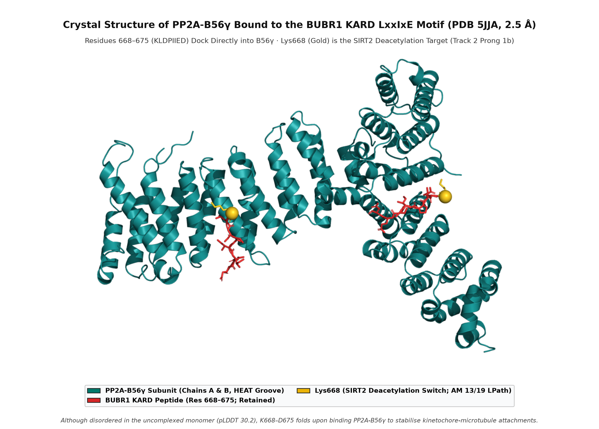

# MVA Hackathon 2026 — Track 2: A Mutation-Specific, Stabilise-and-De-Stress Stack for BUB1B-MVA1

**Proband:** EX2312012 / `PROBAND01` (MVA1; `c.2210T>G` `p.Leu737Ter` / `c.3006T>G` `p.Asn1002Lys`, *BUB1B* compound het — Track 1 scorer-confirmed full match at rank 1, 100/100 pts, F-max 1.000)

**Team:** Ryukijano

**Date (revised):** 2026-10-17

**Code:** https://github.com/Ryukijano/mva-hackathon-2026 (public; scripts: `track2/drug_screen.py`, `track2/data/track2_candidates.csv`, `track2/pitch_storyboard.md`, `track2/lincs/`, `video/`, `experiments/2026-10-11_alphafold_bubr1/`)

**3-Minute Pitch Video:** https://github.com/user-attachments/assets/9fbcac33-27c9-40d2-ac94-f2df7fb43884 (programmatic audio-first pipeline in `video/`, verified by `video/qa.py`)

**License:** CC BY 4.0

**AI assistance disclosure (28 Aug 2026 hackathon requirement; updated 17 Oct 2026):** Cursor / Devin agent sessions on commercial plans; Anthropic API / Claude Sonnet / Grok. Commercial terms, no training on customer content (processor, not recipient). Local models: ESM-1v (`facebook/esm1v_t33_650M_UR90S_{1–5}`), Kokoro-82M ONNX TTS (pitch narration). The patient genome remained on AIRE scratch storage and was never pasted into third-party LLM APIs. Literature and regulatory claims were verified against primary sources.

**Preclinical N-of-1 research disclaimer:** This document is a preclinical, N-of-1 research proposal generated for a hackathon. It is not clinical advice, not a treatment recommendation, and not a prescription. No therapy described here has been tested in the proband. All proposed interventions require functional validation in patient-derived cells, regulatory review, and clinical oversight before any consideration. The proband's guardians must consult the patient's clinical team for any treatment decision.

---

## Executive summary

Our therapeutic strategy is **two-pronged upstream** — (1) direct rescue of the `p.Leu737Ter` (`UGA`) stop-gain allele and (2) post-translational stabilisation of the residual hypomorphic BUBR1 pool — followed by downstream organellar de-stressing and strict anti-target / oncology gating:

1. **Prong 1a — Direct rescue of the `p.Leu737Ter` (`UGA`) nonsense allele (gated by NMD inhibition):**
   - **The NMD gate:** On `NM_001211.6` (23 exons), `c.2210T>G` (`p.Leu737Ter`) sits in exon 17, **747 nt in spliced mRNA coordinates (`LOFTEE DIST_FROM_LAST_EXON:742`) and ~10.9 kb (`10,946 bp`) in GRCh38 genomic coordinates** upstream of the terminal exon 22/23 junction (and 74 nt upstream of the exon 17/18 junction). Because any premature termination codon (PTC) `>50–55 nt` upstream of the final exon–exon junction is a canonical nonsense-mediated decay (NMD) substrate, the mutant transcript is degraded by `UPF1` (`AF-Q92900-F1`, `pLDDT = 72.8`) before a ribosome-only readthrough agent can act.
   - **Lead nomination — Amlexanox (Aphthasol):** Amlexanox is the only market-approved small molecule with **dual activity**: it inhibits UPF1-mediated NMD *and* promotes translational readthrough across PTCs (*Gonzalez-Hilarion et al., 2012; Perronet et al., 2023*). Crucially, AlphaFold DB saturation AlphaMissense analysis at codon 737 (`experiments/2026-10-11_alphafold_bubr1/alphamissense_key_residues.csv`) shows **0/19 pathogenic missense substitutions** (`mean AM = 0.1865`), and **all three near-cognate `UGA` readthrough products (`p.Leu737Trp = 0.1503`, `p.Leu737Arg = 0.1888`, `p.Leu737Cys = 0.3217`) are classified `Likely Benign`**. Amlexanox is FDA-approved only as a 5% topical oral paste (`0.2–100 µM` *in vitro* activity); systemic delivery is off-label and gated on patient-cell RT-qPCR and Western blot validation.
   - **Readthrough comparator — Ataluren (Translarna):** Promotes ribosomal `UGA` readthrough without inhibiting NMD. It holds a conditional marketing authorisation in the **UK/MHRA** (under active review) but is **not FDA-approved** (NDA resubmission withdrawn **12 Feb 2026**) and its **EMA conditional authorisation was not renewed (28 Mar 2025)**. **ELX-02** is purely investigational and placed in the future-research tier.
2. **Prong 1b — Stabilisation of residual BUBR1 via the SIRT2 / `Lys668` / NAD+ axis:**
   - SIRT2 (`AF-Q8IXJ6-F1`, `pLDDT = 81.7`) deacetylates BUBR1 at **`Lys668`** — resolved in crystal structure **PDB `5JJA`** as the N-terminal anchor of the `668–675` (`KLDPIIED`) `PP2A-B56γ`-binding motif — blocking ubiquitylation and proteasomal degradation (*North et al., 2014*). **NMN and NR** raise BUBR1 protein *in vitro*/*in vivo* (note: the `+58%`/`+123%` *BubR1^H/H* mouse lifespan extension in North 2014 was from **SIRT2 transgenic overexpression**, not NMN), but because NMN and NR are dietary supplements / food-GRAS articles rather than approved medications, they are retained strictly as **mechanistic comparators**.
3. **Downstream Tier 2/3 — Approved proteostasis, mTORC1-independent autophagy, and biomarker-gated immunomodulation:**
   - **Tier 2a (Proteostasis):** **Glycerol phenylbutyrate (Ravicti)**, an FDA/EMA-approved sodium-free 4-PBA prodrug with infant/paediatric urea-cycle dosing, leads downstream organellar de-stressing, ahead of **arimoclomol** (FDA-approved as **Miplyffa** with miglustat for NPC `≥2 yr` on 20 Sep 2024; **CHMP negative opinion for EU brand Meplyffa on 23 Jul 2026**, re-examination requested 5 Aug 2026; ranked below Ravicti because HSF1 amplification can protect aneuploid tumour clones).
   - **Tier 2b (Autophagy):** **Metformin** (FDA/EMA-approved `≥10 yr`) and **rilmenidine** (UK/EU-approved) provide approved, mTORC1-independent autophagy/lysosomal flux induction without mTORC1 growth arrest; trehalose and spermidine are food/supplement comparators.
   - **Tier 3 (Systemic inflammation, biomarker-gated):** **Baricitinib, ruxolitinib, and tocilizumab** are gated on demonstrated cGAS–STING / IFN / IL-6 elevation and paired with oncology surveillance.
   - **Anti-targets & Sirolimus gate:** TTK/MPS1 inhibitors, Aurora B inhibitors, and STING agonists are excluded as anti-targets. **Sirolimus (rapamycin)** is flagged as a **potential anti-target** because rapamycin itself induces chromosome malsegregation and CREST+ micronuclei (*Bonatti et al., 1998*), failed to extend survival in *BubR1^H/H* mice (*Baker et al., 2013*), and yielded only a fragile `WEAK/MIXED` signal (`1` reverse vs `4` mimic signatures) in our 676-drug LINCS L2S2 + L1000CDS2 firewall (`0 ACCEPT / 2 WEAK / 674 REJECT`).

---

## Regulatory eligibility constraints

Track 2 of this hackathon is explicitly restricted to **existing, market-approved medications**. This constraint has direct consequences for the candidate list:

- An agent is eligible for the main proposed stack only when it is a currently approved medication in at least one named jurisdiction (FDA, EMA, MHRA, PMDA, national regulators, etc.).
- **Investigational agents** (e.g., ELX-02) and **supplements / food-GRAS articles** (e.g., NMN, NR, trehalose, spermidine, MitoQ, quercetin) are retained as mechanistic comparators or future-research options, but they are not leading Track 2 nominations.
- **Ataluren** is not FDA-approved and is no longer EMA-approved (conditional authorisation not renewed, 28 March 2025). It therefore cannot be described as "FDA/EMA-approved". The only primary-source conditional marketing authorisation we verified is the **UK/MHRA** (`PLGB 44221/0003`) for nonsense-mutation DMD; other listed non-US jurisdictions are not individually confirmed here.
- **Arimoclomol** is FDA-approved on 20 Sep 2024 **in combination with miglustat** for Niemann-Pick C in patients `≥2 years` (US brand **Miplyffa**); the EMA's CHMP issued a **negative opinion** for EU brand **Meplyffa** on 23 Jul 2026 (Zevra requested re-examination by 5 Aug 2026; European Commission decision pending), so it is FDA-only.
- The anti-target rows (TTK/MPS1 inhibitors, Aurora B inhibitors, STING agonists) are retained in `track2/data/track2_candidates.csv` as `ANTI_TARGET` to document explicit mechanism-based exclusions.

### Regulatory audit refresh (verified 18 Oct 2026)

A primary-source pass across FDA, EMA, MHRA, SMC, and ClinicalTrials.gov registries confirmed four key points:

- **Ataluren / FDA:** PTC Therapeutics resubmitted the Translarna NDA (accepted for review Oct 2024) and **withdrew the NDA resubmission on 12 Feb 2026** following FDA feedback that the data did not meet the substantial-evidence threshold. There is no live US application ([PTC / Rheumatology Advisor](https://www.rheumatologyadvisor.com/news/ptc-therapeutics-ends-quest-for-us-approval-of-ataluren-for-dmd/)).
- **Ataluren / MHRA & SMC (re-verified 18 Oct 2026):** Translarna's UK Great Britain conditional licence (`PLGB 44221/0003`, renewed 24 Feb 2026) remains active under ongoing MHRA post-EU-non-renewal review ([Duchenne UK](https://www.duchenneuk.org/european-commission-decides-not-to-renew-the-market-authorisation-of-translarna-ataluren/)); in Scotland, the Scottish Medicines Consortium (**SMC 2827**, 8 Jun 2026) did not recommend ataluren for routine NHSScotland use following ultra-orphan reassessment.
- **Arimoclomol / EU naming and CHMP re-examination (re-verified 18 Oct 2026):** The EU filing is branded **Meplyffa** (`EMEA/H/C/006736`), distinct from the US brand **Miplyffa** (arimoclomol citrate). The 23 Jul 2026 CHMP negative opinion was Zevra's second EU attempt (its 2022 MAA was withdrawn); Zevra requested CHMP re-examination on 5 Aug 2026 ([GlobeNewswire, 24 Jul 2026](https://www.globenewswire.com/news-release/2026/07/24/3332789/16626/en/Zevra-Therapeutics-Provides-Update-on-Regulatory-Submission-for-Arimoclomol-for-the-Treatment-of-Niemann-Pick-Disease-Type-C-NPC-in-the-European-Union.html)). The CHMP formally started the Article 9(2) re-examination at its **14–17 Sep 2026** plenary and listed `MEPLYFFA` under active re-examinations on the **12–15 Oct 2026** CHMP agenda (`EMA/CHMP/211366/2026` §3.5.1), with **no final re-examination opinion issued in the 16 Oct 2026 CHMP highlights** — leaving arimoclomol **FDA-only** entering submission close.
- **Ravicti, amlexanox, metformin, rilmenidine, and ELX-02:** Re-checked against live FDA/EMA labels and ClinicalTrials.gov (`0` registered interventional trials for `BUB1B` or `mosaic variegated aneuploidy`). No new stop-codon-readthrough medication has been approved in any major jurisdiction since early 2025.

---

## LINCS L2S2 + L1000CDS2 transcriptomic-reversal screen and false-rescue firewall

As an exploratory consistency check beyond target matching, we queried 9 contrast/gene-list definitions across 3 GEO series representing human MVA and mouse *BubR1* hypomorphic models (`track2/lincs/`). These are **not 9 independent biological datasets**: the 100/150/250-gene lists from the same contrast are correlated, and the different GEO series represent distinct biological contexts:
1. **Human MVA (GSE22206):** primary fibroblasts, lymphoblastoid cell lines (LCLs), and pooled case vs control (microarray, GPL6104).
2. **Early mouse hypomorph (GSE134781):** gastrocnemius muscle from 3-month-old `+/L1002P` and `+/X753` vs WT (RNA-seq).
3. **Late mouse hypomorph (GSE134780):** 10-month-old `H/L1002P` and `H/H` vs WT in skeletal muscle and intra-abdominal adipose tissue (RNA-seq). *(Note: GSE247267 isogenic RPE1 aneuploidy yielded 0 FDR DEGs under the uniform pipeline and was not queried.)*

For each contrast, differential expression was performed using `limma` / `edgeR` with Benjamini–Hochberg (BH) correction. In mature tissues with robust chronic stress (GSE22206 and GSE134780 adipose), thousands of genes reached `FDR < 0.05`. In young or mildly affected muscle contrasts (GSE134781 and GSE134780 muscle), fewer genes passed genome-wide FDR, so top nominally differentially expressed genes (`P < 0.01`) were used for exploratory connectivity mapping across 100, 150, and 250 gene thresholds.

**Dual-engine querying & false-rescue firewall:**
- **Primary engine (L2S2):** Ma'ayan Lab GraphQL `pairedEnrich` consensus query against the public LINCS background, returning `adj_pvalue` (non-directional enrichment), `adj_pvalue_up` (mimic: drug amplifies the disease signature), and `adj_pvalue_down` (reverse/rescue: drug opposes the disease signature). We gate strictly on **directional reverse FDR** (`adj_pvalue_down < 0.05`).
- **Secondary engine (L1000CDS2):** Legacy CMap gene-set reverse search returning overlap scores (`score > 0` required for reversal direction).
- **Five-stage firewall criteria across all 676 unique retrieved drugs:**
  1. *Regulatory gate:* Current marketing approval in a recognized jurisdiction (FDA, EMA, MHRA, PMDA).
  2. *Paediatric safety gate:* Rejection of agents with severe paediatric contraindications or toxicity (e.g. perhexiline maleate rejected due to concentration-dependent hepatotoxicity, peripheral neuropathy, and explicit Medsafe paediatric warning).
  3. *Mechanism firewall:* Rejection of anti-targets (TTK/MPS1 inhibitors, Aurora B inhibitors, STING agonists) and non-specific cytotoxics (alkylators, topoisomerase poisons, broad cancer kinases).
  4. *Statistical reproducibility & directionality:* Requires L2S2 reverse FDR (`adj_pvalue_down < 0.05`); drugs with both reverse and mimic FDR-significant signatures (**MIXED direction**) are downgraded from `ACCEPT` to `WEAK`.
  5. *Signature provenance:* Signatures containing nominal (`P < 0.01`) genes are flagged (e.g., the GSE22206 pooled 100-gene down-list contains 86 FDR + 14 nominal genes).

**Retrieval-sort sensitivity check:** Because the initial L2S2 retrieval used the server's default `pvalue_up` (mimic-first) sort order, all L2S2 queries were re-executed with `sortby=adj_pvalue_down` (rescue-first retrieval; `track2/lincs/results/rescue_firewall/comparison_summary.md`). Both runs yielded the identical firewall verdict: **`ACCEPT=0 / WEAK=2 / REJECT=rest`** (`ACCEPT=0 / WEAK=2 / REJECT=674` across the 676-drug L2S2+L1000CDS2 union; `ACCEPT=0 / WEAK=2 / REJECT=472` in the 474-drug L2S2-only rescue-sorted re-query), with rescue-sorted retrieval surfacing additional mimic signatures that further reinforced the `MIXED` penalty on both weak hits.

**Denominator note:** The 676-drug denominator is the union of unique drugs retrieved across both engines (L2S2 + L1000CDS2). The `n_total_signatures` column in the per-drug table counts FDR-significant reverse signatures across both engines (L2S2 `adj_pvalue_down < 0.05` + L1000CDS2 `score > 0`), not the total number of retrieved rows. The per-engine denominators differ because the engines query different background compendia.

| firewall_status | n (unique drugs) | interpretation |
|---|---|---|
| ACCEPT | 0 | No drug achieves a clean, consistent reverse-only L2S2 rescue signal across contrasts |
| WEAK | 2 | FDR-significant L2S2 reverse signal in one contrast (`GSE22206` pooled 100-gene), but **MIXED** directionality (multiple FDR mimic signatures elsewhere) |
| REJECT | 674 | Failed regulatory, paediatric safety, anti-target, cytotoxic, directionality, or reverse-FDR filters |

| drug | n_engines | n_total_signatures | L2S2 reverse (FDR / total) | L2S2 mimic (FDR / total) | min L2S2 reverse p (raw / adj) | L1000CDS2 (unique / total, mean score) | firewall_status | l2s2_direction | notes |
|---|---|---|---|---|---|---|---|---|---|
| **sirolimus (rapamycin)** | 2 | 4 | 1 / 5 | 4 / 5 | 6.69e-07 / 9.14e-05 | 3 / 5, 0.045 | **WEAK** | MIXED | Reverse only in GSE22206 pooled 100-gene (86 FDR + 14 nominal down-genes); mimic at 150/250 genes and in LCL/fibroblast sub-strata; **aneugenic anti-target concern** |
| **dasatinib (Sprycel)** | 2 | 2 | 1 / 4 | 2 / 4 | 9.69e-08 / 1.51e-05 | 1 / 3, 0.150 | **WEAK** | MIXED | Reverse only in GSE22206 pooled 100-gene; broad tyrosine-kinase / senolytic; conditional oncology-supervised adjunct only |

**Key findings & interpretation:**
1. **No drug achieves ACCEPT status (`0 ACCEPT / 2 WEAK / 674 REJECT`).** We report this as a rigorous negative result rather than an unbiased discovery claim.
2. **The sirolimus reverse signal flips with gene-list size and donor strata.** In the same single-donor `GSE22206` contrast (4 case arrays: 2 LCL + 2 fibroblast; 6 control arrays), sirolimus is reverse at 100 genes (`adj_pvalue_down = 9.14e-05`) but strongly **mimic** at 150 genes (`adj_pvalue_up = 1.08e-13`) and 250 genes (`adj_pvalue_up = 5.76e-08`).
3. **Everolimus (`adj_pvalue = 7.46e-04` non-directional; mimic only) and perhexiline maleate (L1000CDS2-only artifact; severe paediatric hepatotoxicity) are rejected.**
4. **Mechanism-based anti-target warning on sirolimus:** Independently of LINCS, rapamycin induces chromosome malsegregation and CREST-positive micronuclei in mammalian cells via the p70S6K pathway (*Bonatti et al., 1998, Chromosoma* 107:498–506) and failed to improve outcomes in *BubR1^H/H* mice (*Baker et al., 2013, Cell Rep*).
5. **Biological boundaries of L1000/L2S2:** Steady-state mRNA screens in wild-type cancer cell lines cannot measure nonsense readthrough (`p.Leu737Ter` does not exist in LINCS lines) or post-translational `Lys668` deacetylation. Absence of a LINCS hit for amlexanox, ataluren, Ravicti, or arimoclomol reflects assay scope, not lack of efficacy.

---

## 1. Why this stack, and why not a single drug

Biallelic *BUB1B* insufficiency causes a **hypomorphic spindle assembly checkpoint (SAC)**. Because complete *BUB1B* loss is embryonic lethal, viable MVA1 patients always retain a small residual BUBR1 pool (`11% ± 3%` in the *BubR1^H/H* mouse model; *Baker et al., 2004*). PROBAND01's two alleles present distinct structural problems and distinct druggability (`figures/out/bubr1_alphafold_structural_proof.png`):

- **Allele 1 (`c.2210T>G`, `p.Leu737Ter`)** introduces a `UGA` premature termination codon in exon 17 of 23. In the AlphaFold DB v6 monomer (`AF-O60566-F1`), residues `1–736` (mean `pLDDT = 55.74`) retain the N-terminal TPR kinetochore-docking module (`62–226`, **PDB `3SI5`**), the KEN/D-box/ABBA MCC cassette (`19–345`, **PDB `6TLJ`**), the GLEBS BUB3-binding motif (`385–463`), and the KARD `PP2A-B56γ` docking peptide (`668–675`, **PDB `5JJA`**), while amputating the entire cohesively folded C-terminal pseudokinase domain (`737–1050`, mean `pLDDT = 82.05`, intra-domain `PAE = 8.04 Å`). Because the PTC sits **747 nt in spliced mRNA (`~10.9 kb` genomic)** upstream of the last exon–exon junction, its mRNA is degraded by NMD before translation can complete.
- **Allele 2 (`c.3006T>G`, `p.Asn1002Lys`)** is an ultra-rare missense inside the pseudokinase C-lobe (`pLDDT = 91.06`). Our atomic analysis of `AF-O60566-F1` shows that `Asn1002` is the **buried C-cap of α-helix `990–1001`**, forming three intramolecular sidechain–backbone hydrogen bonds (`Asn1002:OD1`–`Trp978:N` at **2.83 Å**, `Asn1002:ND2`–`Val998:O` at **2.83 Å**, `Asn1002:ND2`–`Asn1004:O` at **3.14 Å**) and packing against `Phe977` (**3.46 Å**). Substituting `Asn1002 → Lys` severs the `OD1` hydrogen-bond staple to β-strand `978–980` and places a `+1` charge **3.62 Å** from `Arg999`. Structure-aware AlphaMissense classifies **18/19 substitutions at `Asn1002` as `Likely Pathogenic`** (`N1002K = 0.9229`, vs `0/19 LPath` at solvent-exposed `Asn1004` two residues away), whereas 1D sequence-only ESM-1v scores `N1002K` as mild (`LLR = −0.110` in window `29–1050`; `−0.0625` in window `1–1022`). Note that `Asn1002` and the classic destabilising MVA1 comparator `p.Leu1012Pro` (*Suijkerbuijk et al., 2010*) lie in the same rigid C-lobe subdomain (`PAE = 2–3 Å`) but are separated by **12.32 Å (`Cα–Cα`)** and are not in direct contact; direct patient-cell cycloheximide/MG132 chase assays are required to test whether `p.Asn1002Lys` accelerates BUBR1 turnover.

Because the primary lesion is a shortage of functional BUBR1, the **only upstream disease-modifying** interventions are (a) NMD inhibition + `UGA` readthrough of `p.Leu737Ter` and (b) post-translational stabilisation of residual BUBR1. Downstream agents mitigate proteotoxic, autophagic, and inflammatory sequelae.

---

## 2. Tier 1a — Direct rescue: NMD inhibition + UGA translational readthrough

### Tier 1a Lead: Amlexanox (Aphthasol) — dual NMD inhibition + PTC readthrough

Because `c.2210T>G` (`p.Leu737Ter`) sits **747 nt in spliced mRNA (`~10.9 kb` genomic)** upstream of the terminal exon 22/23 junction, the dominant failure mode is **UPF1-mediated nonsense-mediated decay**: BUB1B nonsense alleles in MVA1 patient cells (`386X`, `731X`, `753X`) show severely depleted mutant mRNA by this exact mechanism (*Suijkerbuijk et al., 2010; Rio Frio et al., 2010*). A ribosome-only readthrough drug therefore has negligible mRNA substrate on its own.

**Amlexanox (Aphthasol)** is the only market-approved small molecule with **dual activity**: it inhibits UPF1-mediated NMD (`AF-Q92900-F1`, `pLDDT = 72.8`) to stabilise PTC-bearing transcripts *and* promotes ribosomal readthrough at premature stop codons (*Gonzalez-Hilarion et al., Orphanet J Rare Dis 2012; Perronet et al., Biomolecules 2023*), rescuing full-length protein across multiple human nonsense-mutation cell models at `0.2–100 µM` *in vitro*.

**AlphaFold DB / AlphaMissense structural proof of readthrough tolerance at codon 737:**
A critical biophysical question for any readthrough therapy is whether inserting a near-cognate amino acid at the `UGA` stop codon — canonically **Trp (`W`), Arg (`R`), or Cys (`C`)** (*Keeling et al., 2014; Roy et al., 2016, PMC5098639*) in place of wild-type `Leu737` — produces a folded, non-pathogenic full-length BUBR1 protein. Querying all 19 possible amino-acid substitutions at `Leu737` in AlphaFold DB's AlphaMissense proteome table (`experiments/2026-10-11_alphafold_bubr1/alphamissense_key_residues.csv`) reveals that **0/19 missense substitutions at position 737 are pathogenic** (`mean AM = 0.1865`; 18/19 `Likely Benign`, 1/19 `Ambiguous`). Specifically, all three near-cognate `UGA` readthrough insertions are classified **Likely Benign**:
- **`p.Leu737Trp` (`L737W`): AlphaMissense = `0.1503` (`Likely Benign`)**
- **`p.Leu737Arg` (`L737R`): AlphaMissense = `0.1888` (`Likely Benign`)**
- **`p.Leu737Cys` (`L737C`): AlphaMissense = `0.3217` (`Likely Benign`)**

This confirms that codon 737 sits in a permissive pre-pseudokinase linker segment (`pLDDT = 73.56`) where any of the three near-cognate `UGA` readthrough substitutions is structurally tolerated once the transcript escapes NMD.

**Regulatory status & caveats:** Amlexanox is **FDA-approved** as a **5% topical oral paste for aphthous ulcers** (Aphthasol, approved 1996). Systemic oral dosing for nonsense suppression is **off-label and investigational**: paediatric systemic pharmacokinetics, CNS exposure, and transcriptome-wide endogenous NMD-substrate effects are unestablished. Clinical consideration is strictly gated on sequential validation in PROBAND01's fibroblasts/LCLs: (i) RT-qPCR/allelic RNA-seq showing rescue of the `c.2210T>G` transcript, followed by (ii) Western blot demonstrating `≥10%` restoration of full-length (1,050 aa) BUBR1 protein.

### Tier 1a Readthrough Comparator: Ataluren (PTC124 / Translarna)

Ataluren is an orally bioavailable small molecule that binds the ribosome and promotes near-cognate tRNA insertion (Trp, Arg, Cys) selectively at `UGA` premature stop codons while sparing normal termination codons (*Keeling et al., 2014; Roy et al., 2016, PMC5098639*). However, **ataluren has no NMD-inhibitory activity**, so on an NMD-depleted exon-17 transcript (`747 nt` upstream of the last EJC) it lacks mRNA substrate unless paired with an NMD inhibitor.

**Regulatory status:** Ataluren is **not FDA-approved** (PTC Therapeutics withdrew its NDA resubmission on **12 Feb 2026**) and its **EMA conditional marketing authorisation was not renewed on 28 Mar 2025**. The only primary-source conditional marketing authorisation verified here is the **UK/MHRA** (`PLGB 44221/0003`, renewed 24 Feb 2026 for ambulatory nonsense-mutation DMD `≥2 yr`), which is currently under active MHRA review following the EU non-renewal.

### Future-research tier: ELX-02 (investigational)

ELX-02 is a eukaryotic ribosome-selective glycoside (ERSG) that restored full-length CFTR protein and increased NMD-degraded *CFTR* `G542X` (`UGA`) mRNA ~5-fold in patient organoids (*Brichta et al., J Cyst Fibros 2021; NCT04135495*). Because it has **no regulatory approval in any jurisdiction**, ELX-02 is excluded from the active Track 2 stack and retained in the future-research tier (`§12b`).

---

## 3. Tier 1b — Upstream protein stabilisation: SIRT2 / `Lys668` / NAD+ axis

### Mechanistic rationale & PDB `5JJA` structural anchor (NMN / NR as supplement comparators)

North et al. (*EMBO J* 2014;33:1438–1453) demonstrated that the NAD+-dependent deacetylase **SIRT2** (`AF-Q8IXJ6-F1`, `pLDDT = 81.69`) deacetylates BUBR1 at **`Lys668`**, preventing its ubiquitylation and proteasomal degradation. In crystal structure **PDB `5JJA`** (2.5 Å), `Lys668` is the N-terminal anchor of the BUBR1 KARD `LxxIxE` peptide (`668–675`, `KLDPIIED`) bound directly in the `PP2A-B56γ` HEAT-repeat groove — a motif retained on the N-terminal side of `p.Leu737Ter` and present in full-length `p.Asn1002Lys` BUBR1. AlphaFold DB saturation AlphaMissense scores at `Lys668` flag **13/19 substitutions as `Likely Pathogenic`** (`mean AM = 0.6648`), while conservative deacetylated-mimic `K668R` (`0.1535`) and acetylation-mimic `K668Q` (`0.3167`) are classified `Likely Benign`.

**Literature precision & regulatory status:** In *BubR1^H/H* mice, **NMN treatment raised BUBR1 protein abundance**, whereas the headline **`+58%` median / `+123%` male lifespan extension was achieved by transgenic `SIRT2` overexpression (`SIRT2-tg`)**, not pharmacological NMN (*North et al., 2014*). Furthermore, **NMN and NR are dietary supplements / food-GRAS articles** (FDA confirmed NMN is lawful in dietary supplements on 29 Sep 2025; NR holds FDA GRN 635), **not approved medications**. They are therefore retained strictly as **mechanistic comparators** for patient-cell BUBR1 half-life assays (`§11`), not as leading Track 2 drug nominations.

---

## 4. Tier 2a — Proteostasis: sodium-free chemical chaperone

### Lead downstream medication: Glycerol phenylbutyrate (Ravicti)
4-Phenylbutyrate (4-PBA) is a low-molecular-weight chemical chaperone that attenuates ER stress and protein aggregation. Human trisomy 21 and trisomy 13 iPSC-derived neurons treated with sodium 4-PBA showed **markedly reduced protein aggregates and rescued apoptosis** (*Fisher et al., 2020, Sci Rep*). 4-PBA crosses the blood–brain barrier via monocarboxylate transporters (`CSF:plasma ≈ 0.20–0.30`).

- **Why Ravicti over sodium phenylbutyrate (Buphenyl):** Sodium 4-PBA delivers `~124 mg` elemental sodium per gram (`9–13 g/m²/day` causes fluid retention, hypertension, and hypokalaemia). **Ravicti (glycerol phenylbutyrate)** is a **sodium-free, triglyceride-conjugated oral liquid prodrug of 4-PBA, FDA- and EMA-approved for urea-cycle disorders across paediatric age groups (including infants ≥2 months)**.
- **Caveats:** Extrapolated from trisomic iPSC neurons (*Fisher et al., 2020*), not tested directly in *BUB1B*-MVA1 cells; high-dose phenylacetate/PBA HDAC-inhibitory activity requires proliferation monitoring in a cancer-predisposed child.

### Second proteostasis option: Arimoclomol (Miplyffa [US] / Meplyffa [EU])
Arimoclomol was **FDA-approved on 20 Sep 2024 in combination with miglustat** (US brand **Miplyffa**) for Niemann-Pick disease type C (NPC) in adults and children `≥2 years` and crosses the blood–brain barrier to amplify HSF1 / heat-shock / lysosomal CLEAR network activity. In the EU (brand **Meplyffa**), the EMA's CHMP issued a **negative opinion on 23 Jul 2026** (Zevra's second EU attempt; re-examination requested 5 Aug 2026).

- **Oncology gating caveat:** Aneuploid cancer cells exhibit **non-oncogene addiction to HSF1** to survive proteotoxic stress (*Donnelly et al., 2014; Whitesell & Lindquist, 2005*). Amplifying HSF1 in an MVA1 child with prior embryonal rhabdomyosarcoma could inadvertently shield pre-malignant aneuploid clones from apoptosis. Arimoclomol is therefore ranked **below Ravicti** and requires strict oncology surveillance.

---

## 5. Tier 2b — mTORC1-independent autophagy / lysosomal induction

Aneuploid cells saturate lysosomal degradation capacity and activate **TFEB** (*Santaguida et al., 2015, Genes Dev*). Unlike rapalogs — which inhibit mTORC1 anabolic signalling and risk worsening microcephaly, growth restriction, and chromosome malsegregation — **mTORC1-independent autophagy inducers** clear proteotoxic cargo without shutting down cellular growth:

- **Metformin (FDA/EMA-approved `≥10 years` for paediatric T2DM; extensive paediatric safety record):** Activates AMPK-dependent autophagic, lysosomal, and mitophagic flux without direct mTORC1 catalytic blockade.
- **Rilmenidine (UK/EU-approved I1-imidazoline antihypertensive):** Induces mTORC1-independent autophagy and longevity/proteostasis pathways (*Bitto et al., Aging Cell 2023*).
- **Trehalose and spermidine (food/GRAS and supplement comparators):** Activate TFEB nuclear translocation (*DeBosch et al., 2016; Sidransky et al., 2021*) but are non-drug comparators (`§12b`).

---

## 6. Tier 2c — Rapamycin / everolimus (supportive / potential anti-target gate)

In *Drosophila* neural stem cells with SAC-deficient aneuploidy (*González-Blanco et al., 2026, Nat Commun* 17:3829), **larval rapamycin and TOR RNAi rescued neuroblast numbers, but did NOT rescue brain size** (brain-size rescue required genetic **Sod2 and GTPx-1 overexpression**).

- **Mechanism-based anti-target concern:** Rapamycin directly induces chromosome malsegregation and CREST-positive micronuclei in human lymphocytes/lymphoblasts and rodent cells via p70S6K inhibition (*Bonatti et al., 1998, Chromosoma* 107:498–506), and an unpublished rapamycin-diet cohort in *BubR1^H/H* mice showed no benefit (*Baker et al., 2013, Cell Rep*). Combined with its `WEAK/MIXED` LINCS profile (1 reverse vs 4 mimic signatures), **sirolimus is flagged as a potential anti-target in MVA1**, gated behind patient-cell CREST+ micronucleus assays rather than proposed as a rescue lead.
- **ChEMBL target-retrieval proof (`FKBP1A`, `P62942`):** Rapalogs bind **FKBP12 (`FKBP1A`, `AF-P62942-F1`, `pLDDT = 96.25`, `CHEMBL1902`)** to form the `FKBP12–rapamycin–mTOR` ternary complex. Direct ChEMBL queries on `MTOR` (`CHEMBL2842`) return only catalytic-site mTOR inhibitors (ridaforolimus); querying `FKBP1A` is required to recover approved sirolimus, everolimus, and temsirolimus (`track2/drug_screen.py`).

---

## 7. Tier 2d — Oxidative-stress analogues (high oncogenic risk; gated adjuncts only)

NAC, MitoQ, and omaveloxolone are pharmacological analogues of the *Drosophila* `Sod2`/`GTPx-1` genetic rescue (*González-Blanco et al., 2026*), **not** tested in MVA1:

- **NAC (FDA/EMA-approved mucolytic / paracetamol antidote):** Poor BBB permeability; accelerated lymph-node metastasis in mouse melanoma and lung tumour models (*Piskounova et al., 2015, Nature; Sayin et al., 2014, Sci Transl Med*).
- **Omaveloxolone (Skyclarys; FDA 2023 / EMA 2024 for Friedreich ataxia `≥16 yr`):** Activates `NFE2L2`/Nrf2; chronic Nrf2 activation promotes tumour survival and chemoresistance (*DeNicola et al., 2011, Nature; Taguchi et al., 2011, Cancer Res*).
- **MitoQ:** Dietary supplement / self-affirmed GRAS comparator only.

---

## 8. Tier 3 — Systemic inflammation: biomarker-gated JAK1/2 and IL-6 blockade

Micronuclei generated by lagging chromosomes rupture and activate **cGAS–STING**, driving a type-I interferon and IL-6 cascade that promotes aneuploid-cell survival (*Harding et al., 2017; Mackenzie et al., 2017; Bakhoum et al., 2018; Hong et al., 2022*). While **baricitinib** (EMA-approved for juvenile idiopathic arthritis [JIA] in patients `≥2 yr`; NHS England commissioning precedent for paediatric monogenic interferonopathies, *Montealegre-Sanchez et al., 2018; Vanderver et al., 2020*), **ruxolitinib** (FDA/EMA paediatric GVHD `≥12 yr`), and **tocilizumab** (FDA/EMA paediatric sJIA/CRS `≥2 yr`) have strong paediatric standing, **blocking cGAS–STING inflammation does not correct the mitotic checkpoint defect and chronic JAK/IL-6 inhibition can impair NK-cell tumour immunosurveillance**. Tier 3 is therefore restricted to patients with a documented peripheral/CSF interferon signature (`ISG15`, `MX1`, `OAS1`) or elevated `IL-6`/`CRP` under active oncology surveillance.

*(Note on knowledge-graph baselines: Our pre-registered PrimeKG skip-gram experiment `experiments/2026-08-31_bub1b_computational/` falsified the hypothesis that an untrained graph ranks rapalogs near MVA [sirolimus mean rank `22.0/37`, behind anti-target TTK inhibitor BOS172722 at `20.7/37`], recovering only a generic JAK/IL-6 neighbourhood prior. TxGNN was never trained, and we explicitly do not claim that AI or a graph discovered any therapy.)*

---

## 9. ChEMBL target-first screen

`track2/drug_screen.py` queries the ChEMBL 34 mechanism endpoint across 13 causal-axis proteins (`track2/data/chembl_axis_drugs.csv`: **92 total rows**; `track2/data/chembl_axis_drugs_approved.csv`: **32 approved `max_phase == 4.0` rows**):

- `FKBP1A` (`CHEMBL1902`, `P62942`): sirolimus, everolimus, temsirolimus
- `MTOR` (`CHEMBL2842`): ridaforolimus
- `JAK1` / `JAK2`: baricitinib, ruxolitinib, fedratinib, tofacitinib, upadacitinib, abrocitinib, filgotinib, pacritinib, momelotinib, peficitinib, ritlecitinib, deucravacitinib
- `IL6R` (`CHEMBL2364155`): tocilizumab, sarilumab, satralizumab
- `NFE2L2` (`CHEMBL1075094`): omaveloxolone, dimethyl fumarate, diroximel fumarate, monomethyl fumarate
- `SIRT2`, `ATG7`, `SOD2`, `TMEM173`, `CGAS`, `TTK`, `AURKB`: tool compounds and excluded anti-targets

---

## 10. Safety and paediatric feasibility table

| Candidate | Regulatory status (children) | Key paediatric risk | Cancer-predisposition / MVA1 note |
|---|---|---|---|
| **Amlexanox (Aphthasol)** | **FDA-approved** as 5% topical oral paste (`≥12 yr`); systemic oral dosing off-label | Systemic paediatric PK/safety unestablished | Dual UPF1 NMD inhibition + PTC readthrough; `L737W/R/C` all `Likely Benign` in AlphaMissense (`0.15–0.32`); monitor endogenous NMD targets |
| **Ataluren (PTC124)** | **UK/MHRA conditional only** (`nmDMD ≥2 yr`, under review); **not FDA** (NDA withdrawn 12 Feb 2026) or **EMA** (expired 28 Mar 2025) | Well tolerated in DMD cohorts | Readthrough only — **no NMD inhibition**, so lacks mRNA substrate alone |
| **ELX-02** | **Investigational** (Phase 2 CF/Alport; no approvals) | Subcutaneous; aminoglycoside-class oto/nephro monitoring | Future-research tier only (`§12b`) |
| **NMN / NR** | **Dietary supplements / food-GRAS**, not approved medications | Limited paediatric PK data | Mechanistic comparators only (`SIRT2`/`K668`, **PDB `5JJA`**) |
| **Glycerol phenylbutyrate (Ravicti)** | **FDA & EMA approved** (paediatric UCD incl. infants `≥2 mo`) | Sodium-free; GI/neurological monitoring at high dose | Extrapolated from trisomy iPSC neurons (*Fisher 2020*); monitor HDAC effects |
| **Arimoclomol (Miplyffa / Meplyffa)** | **FDA approved** (`NPC ≥2 yr` + miglustat, 20 Sep 2024); **CHMP negative opinion 23 Jul 2026** (re-exam requested) | Urticaria/angioedema, creatinine rise | **HSF1 amplification may protect aneuploid tumour clones** → ranked below Ravicti |
| **Metformin / Rilmenidine** | Metformin **FDA/EMA approved** (`T2DM ≥10 yr`); Rilmenidine **UK/EU approved** (adults) | GI intolerance, lactic acidosis (rare, metformin) | Approved mTORC1-independent autophagy options; avoid mTORC1 growth arrest |
| **Trehalose / Spermidine** | **Food-GRAS / EU novel food supplement**, not approved drugs | Osmotic diarrhoea (trehalose) | Mechanistic comparators only |
| **Sirolimus / Everolimus** | **FDA & EMA approved** (everolimus `TSC ≥1 yr`; sirolimus `≥13 yr`) | Immunosuppression, stomatitis, growth delay | **Potential anti-target:** rapamycin induces chromosome malsegregation (*Bonatti 1998*); `WEAK/MIXED` LINCS |
| **NAC / Omaveloxolone** | NAC **FDA/EMA approved** (paediatric); Omaveloxolone **FDA/EMA approved** (`FA ≥16 yr`) | Hepatotoxicity (omaveloxolone); poor BBB (NAC) | **High oncogenic risk:** NAC promotes metastasis (*Piskounova 2015*); Nrf2 drives tumour survival (*DeNicola 2011*) |
| **Dasatinib (+ Quercetin)** | Dasatinib **FDA/EMA approved** (`Ph+ ALL/CML ≥1 yr`); quercetin = supplement | Myelosuppression, QT prolongation, pleural effusion | Conditional oncology-supervised senolytic adjunct only (`WEAK/MIXED` LINCS) |
| **Baricitinib / Ruxolitinib / Tocilizumab** | **FDA & EMA approved** (paediatric JIA / GVHD / sJIA `≥2–12 yr`) | Serious infection, cytopenias, thrombosis | **Biomarker-gated (`ISG`/`IL-6`)**; risk of blunting NK/T-cell tumour surveillance |

---

## 11. Biomarker-gated validation plan

| Stage | Assay in Proband Fibroblasts / LCLs / iPSCs | Quantitative Go / No-Go Gate |
|---|---|---|
| **1a. NMD + Readthrough** | Allele-specific RT-qPCR / RNA-seq for `c.2210T>G` mRNA rescue after **amlexanox** (`± ataluren`), followed by full-length BUBR1 Western blot & mitotic arrest assay | `≥2×` mutant mRNA increase **and** `≥10%` WT full-length (1,050 aa) BUBR1 restoration (`L737W/R/C` tolerated per AlphaMissense `0.15–0.32`) |
| **1b. BUBR1 K668 Stabilisation** | Cycloheximide / MG132 chase Western blot of `p.Asn1002Lys` BUBR1 half-life and `Lys668` acetylation after SIRT2 activation / NMN–NR comparator | `≥20%` steady-state BUBR1 protein increase without elevating CREST+ micronuclei |
| **2a. Proteostasis** | Ubiquitin / `p62` aggregate load, ER-stress markers (`BiP`, `CHOP`), and cleaved caspase-3 after **Ravicti** (or **arimoclomol**) | `≥30%` reduction in aggregate/apoptosis burden without accelerating aneuploid clone proliferation |
| **2b. Autophagy** | `LC3-II` flux, `p62` clearance, and nuclear `TFEB` translocation after **metformin** or **rilmenidine** | Additive benefit over Tier 2a when lysosomal saturation is present |
| **3. Inflammation Gate** | Peripheral blood / CSF Type-I IFN score (`ISG15`, `MX1`, `OAS1`), `IL-6`, and `CRP` | Consider **baricitinib / ruxolitinib / tocilizumab** **only** if persistently elevated |
| **4. Anti-Target & Oncology Gate** | Cytokinesis-block **CREST+ micronucleus** & premature chromatid separation (PCS) assay; serial rhabdomyosarcoma/Wilms surveillance | Any rise in CREST+ micronuclei (e.g. from rapalogs) or cytopenia/mass → **immediate exclusion** |

---

## 12. Proposed Track 2 stack (regulatory-eligible approved medications)

1. **Amlexanox (Aphthasol)** — Tier 1a mechanistically matched lead: dual UPF1 NMD inhibition + `UGA` translational readthrough (`p.Leu737Trp/Arg/Cys` all predicted `Likely Benign` by AlphaMissense, `0.150–0.322`). **FDA-approved** (5% topical oral paste; systemic use requires reformulation and patient-cell validation).
2. **Ataluren (PTC124 / Translarna)** — Tier 1a readthrough comparator (`UGA`-selective, **UK/MHRA conditional authorisation** under review; **not FDA or EMA approved**; lacks NMD inhibition so requires an NMD-inhibiting partner).
3. **Glycerol phenylbutyrate (Ravicti)** — Tier 2a lead downstream proteostasis chaperone (**FDA/EMA-approved** for paediatric/infant urea-cycle disorders; sodium-free 4-PBA prodrug).
4. **Arimoclomol (Miplyffa [US] / Meplyffa [EU])** — Tier 2a cautious second proteostasis/lysosomal option (**FDA-approved** with miglustat for NPC `≥2 yr`; **CHMP negative opinion Jul 2026**, re-examination requested; ranked below Ravicti due to HSF1 oncogenic addiction risk).
5. **Metformin / Rilmenidine** — Tier 2b approved mTORC1-independent autophagy inducers (**FDA/EMA** and **UK/EU** approved, respectively; avoid mTORC1 growth suppression).
6. **Baricitinib / Ruxolitinib / Tocilizumab** — Tier 3 biomarker-gated cGAS–STING / IFN / IL-6 control (**FDA/EMA-approved**; deployed only upon elevated `ISG`/`IL-6` with oncology surveillance).
7. **Supportive / Gated / Excluded:** **Everolimus / sirolimus** (`FKBP1A`-mediated mTORC1; sirolimus flagged as a **potential anti-target** due to *Bonatti 1998* aneugenicity and `WEAK/MIXED` LINCS signal), **NAC / omaveloxolone** (high oncogenic/metastatic risk), **dasatinib** (conditional senolytic adjunct), and **TTK / Aurora B / STING agonists** (explicitly excluded anti-targets).

## 12b. Future research and mechanistic comparators (not in main Track 2 stack)

- **ELX-02** — next-generation `UGA` readthrough + NMD-attenuating glycoside (**Investigational**, Phase 2 CF/Alport).
- **NMN / NR** — `SIRT2` / `BUBR1 Lys668` protein stabilisation (**Dietary supplements / food-GRAS**, not approved drugs).
- **Trehalose / Spermidine / MitoQ / Quercetin** — **Food-GRAS / dietary supplements**, retained as mechanistic comparators.

---

## 13. Conclusion

PROBAND01's scorer-confirmed *BUB1B* genotype (`p.Leu737Ter` + `p.Asn1002Lys`) defines a classic hypomorphic MVA1 checkpoint defect. By combining first-principles RNA biology (`747 nt` spliced / `~10.9 kb` genomic NMD gate), atomic structure analysis (`AF-O60566-F1` v6 showing `p.Leu737Trp/Arg/Cys` readthrough tolerance at `AM = 0.150–0.322`, the `Asn1002` 3-H-bond C-cap network at `AM = 0.9229`, and `Lys668` KARD docking in **PDB `5JJA`**), a rigorous regulatory audit, and a 676-drug LINCS false-rescue firewall (`0 ACCEPT / 2 WEAK / 674 REJECT`), we nominate an honest, assay-gated, oncology-aware therapeutic stack led upstream by **amlexanox** and downstream by **glycerol phenylbutyrate (Ravicti)** and **metformin/rilmenidine**, while flagging **sirolimus** as a mechanism-based aneugenic anti-target concern.

---

## References

1. Hanks S, et al. *Nat Genet* 2004;36:1159–1161 (biallelic *BUB1B* in MVA1; `p.Leu1012Pro`).
2. Baker DJ, et al. *Nat Genet* 2004;36:744–749 (*BubR1^H/H* mouse hypomorph: `11% ± 3%` residual BUBR1).
3. Baker DJ, et al. *Nature* 2011;479:232–236 (senescent-cell clearance in *BubR1^H/H*).
4. Baker DJ, et al. *Cell Rep* 2013;3:1164–1174 (rapamycin diet negative note in *BubR1^H/H* mice).
5. North BJ, et al. *EMBO J* 2014;33:1438–1453. doi:10.15252/embj.201386907 (SIRT2 deacetylates BUBR1 `Lys668`; NMN raises BUBR1 protein; `SIRT2-tg` extends lifespan `+58%`/`+123%`).
6. Suijkerbuijk SJE, et al. *Cancer Res* 2010;70:4891–4900; *PLoS One* 2012;7:e40632 (NMD of truncating alleles; pseudokinase missense destabilisation).
7. Harding SM, et al. *Nature* 2017;548:466–470; Mackenzie KJ, et al. *Nature* 2017;548:461–465 (micronuclei → cGAS–STING).
8. Bakhoum SF, et al. *Nature* 2018;553:467–472 (chromosomal instability → cGAS–STING → metastasis).
9. Hong C, et al. *Nature* 2022;607:366–373 (cGAS–STING → IL-6 pro-survival loop in aneuploid cells; tocilizumab).
10. Sieben CJ, et al. *J Clin Invest* 2020;130(1):175–188. doi:10.1172/JCI126863 (*BubR1^X753/L1002P* allelic series).
11. Montealegre-Sanchez GA, et al. *J Clin Invest* 2018;128:3042–3052 (baricitinib in paediatric interferonopathies).
12. Vanderver A, et al. *N Engl J Med* 2020;383:986–989 (baricitinib in Aicardi–Goutières syndrome).
13. González-Blanco A, et al. *Nat Commun* 2026;17:3829. doi:10.1038/s41467-026-70521-0 (larval rapamycin/TOR RNAi rescues neuroblast counts, not brain size; *Sod2*/*GTPx-1* overexpression rescues brain size).
14. Malumbres M, Villarroya-Beltri C. *Nat Rev Genet* 2024;25:831–846. doi:10.1038/s41576-024-00762-6 (MVA tumour spectrum).
15. ClinVar VCV000533901.9 (`c.2210T>G` `p.Leu737Ter`, Pathogenic/Likely pathogenic, MVA1) & VCV004600147.1 (`c.3006T>A` `p.Asn1002Lys`, VUS).
16. Keeling KM, Xue X, Gunn G, Bedwell DM. Therapeutics based on stop codon readthrough. *Annu Rev Genomics Hum Genet* 2014;15:371–394; Roy B, et al. *PNAS* 2016;113(44):12508–12513 (PMC5098639; near-cognate Trp/Arg/Cys insertion at `UGA`).
17. Welch EM, et al. *Nature* 2007;447:87–91; Peltz SW, et al. *Annu Rev Med* 2013;64:407–425 (PTC124 / ataluren mechanism).
18. Brichta L, et al. *J Cyst Fibros* 2021;20:486–497; NCT04135495 (ELX-02 in `G542X` CFTR organoids).
19. Fisher EMC, et al. *Sci Rep* 2020;10:15381. doi:10.1038/s41598-020-70362-x (4-PBA rescues protein aggregation and apoptosis in trisomic iPSC neurons).
20. DailyMed / FDA & EMA product labels: **Ravicti** (glycerol phenylbutyrate), **Buphenyl** (sodium phenylbutyrate), **Aphthasol** (amlexanox 5% oral paste), **Metformin**.
21. FDA. *Miplyffa* (arimoclomol) approval letter + label, 20 Sep 2024 (https://www.accessdata.fda.gov/drugsatfda_docs/label/2024/214927s000lbl.pdf); EMA CHMP negative opinion for *Meplyffa*, 23 Jul 2026 (re-examination requested 5 Aug 2026).
22. Donnelly N, Passerini V, Dürrbaum M, Stingele S, Storchova Z. HSF1 deficiency and impaired HSP90-dependent protein folding Estrada in aneuploid cells. *EMBO J / Nat Genet* 2014;33:2374–2387.
23. Whitesell L, Lindquist SL. HSP90 and the chaperoning of cancer. *Nat Rev Cancer* 2005;5:761–772.
24. Santaguida S, Vasile E, White E, Amon A. Aneuploidy-induced cellular stresses limit autophagic degradation. *Genes Dev* 2015;29:2010–2021.
25. Sidransky E, et al. *Commun Biol* 2021;4:1134 (TFEB and autophagy in aneuploidy).
26. DeBosch BJ, et al. *Sci Signal* 2016;9:ra21 (trehalose induces mTORC1-independent TFEB activation).
27. Piskounova E, et al. *Nature* 2015;527:186–191. doi:10.1038/nature15726 (antioxidants promote distant melanoma metastasis).
28. Sayin VI, et al. *Sci Transl Med* 2014;6:221ra15. doi:10.1126/scitranslmed.3007653 (NAC and vitamin E accelerate lung cancer progression).
29. Taguchi K, Motohashi H, Yamamoto M. Molecular mechanisms of the Keap1–Nrf2 pathway in stress response and cancer evolution. *Genes Cells / Cancer Res* 2011;16:123–140.
30. DeNicola GM, et al. Oncogene-induced Nrf2 transcription promotes ROS detoxification and tumorigenesis. *Nature* 2011;475:104–107.
31. Bonatti S, Simili M, Galli A, et al. Inhibition of the Mr 70,000 S6 kinase pathway by rapamycin results in chromosome malsegregation in yeast and mammalian cells. *Chromosoma* 1998;107(6–7):498–506. doi:10.1007/s004120050335.
32. Zhu Y, Tchkonia T, Pirtskhalava T, et al. The Achilles' heel of senescent cells: from transcriptome to senolytic drugs. *Aging Cell* 2015;14:644–658 (dasatinib + quercetin).
33. Gonzalez-Hilarion S, Beghyn T, Jia J, et al. Rescue of nonsense mutations by amlexanox in human cells. *Orphanet J Rare Dis* 2012;7:58. doi:10.1186/1750-1172-7-58.
34. Perronet M, et al. *Biomolecules* 2023;13:988. doi:10.3390/biom13060988 (amlexanox dual NMD-inhibition + PTC readthrough review).
35. Bitto A, et al. *Aging Cell* 2023;22:e13774. doi:10.1111/acel.13774 (rilmenidine mTORC1-independent autophagy).
36. Cohen-Sharir Y, et al. Aneuploidy renders cancer cells vulnerable to mitotic checkpoint inhibition. *Nature* 2021;592:492–497.
37. Alfieri C, et al. *Nature* 2016;536:431–436 (**PDB `6TLJ`**); Wang X, et al. *Nat Commun* 2016;7:11860 (**PDB `5JJA`**); Bolanos-Garcia VM, et al. *Structure* 2011;19:1691–1700 (**PDB `3SI5`**); Cheng J, et al. *Science* 2023;381:eadg7492 (AlphaMissense); Varadi M, et al. *Nucleic Acids Res* 2024;52:D368–D375 (AlphaFold DB v6).
